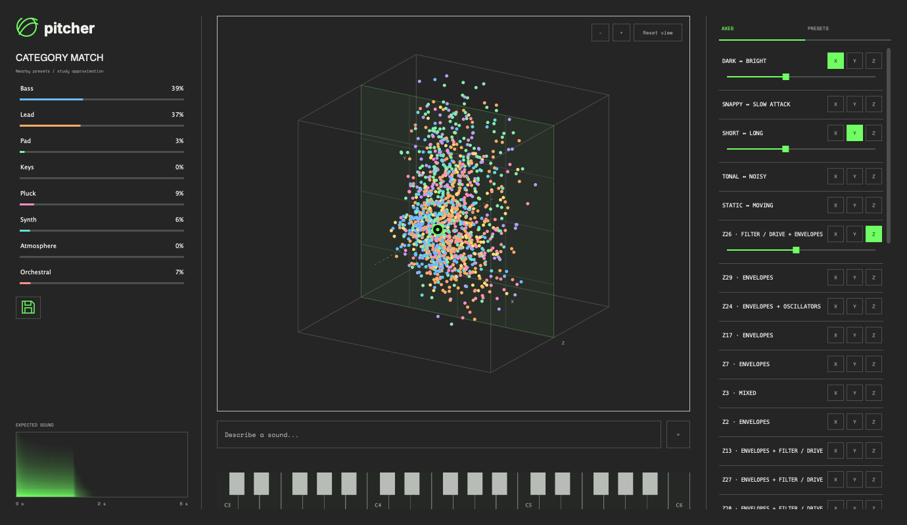

# Pitcher — Brutalist JUCE handoff

Design baseline: 21 October 2026. This document captures the latest approved browser study, not the earlier yellow variants. Implement the native experiment as a **separate JUCE application** in `design-study/juce/`; do not replace the working plugin editor or connect new model/audio behavior as part of the visual translation.

Reference: `design-study/xy-pad/index.html?style=brutalist&view=orbit`. Serve the repository root to use this URL. The browser's style picker and “All studies” navigation are study tooling, not part of Pitcher.

## Layout contract

```text
┌───────────────────┬─────────────────────────────────┬───────────────────┐
│ swish  pitcher    │                      − + Reset  │ AXES    PRESETS   │
│ CATEGORY MATCH    │                                 │                   │
│ closest category  │       orbit preset cloud        │ Label       X Y Z │
│ compact bars      │       + movable XYZ handle      │ low ─────── high  │
│ …                 │                                 │ Label       X Y Z │
│ floppy Save       │                                 │ … scrolls …       │
│                   │ Describe a sound…             ↑ │                   │
│ Expected sound    │                                 │                   │
│ [spectrogram]     │ [C3 … three octaves … C6 piano]  │                   │
│ 0 s    2 s    6 s │                                 │                   │
└───────────────────┴─────────────────────────────────┴───────────────────┘
```

- Left and right sidebars have **equal widths and equal full workspace heights**. The axes list scrolls within its allocated height; it must not expand the window. Left spectrogram sits at the bottom, below category/save content.
- Keyboard belongs **only to the centre column**, below the prompt and viewer. It never extends below either sidebar.
- Reference browser sidebar widths: 240 px at viewport widths 1000–1200 px, 280 px at ordinary desktop widths, 300 px from 1450 px. These are browser CSS reference values, not mandatory JUCE window breakpoints. Use equal native side widths with a flexible centre and prevent overlap at the application's minimum size.
- Reference column gap is 24 px (16 px in the compact desktop range); sidebar inner separator padding is 20 px. Adapt at the native reference size while retaining compact density.
- Do not preserve an empty top toolbar/header row. Identity is at the top of the left column.
- Keep main background continuous across all three columns and the viewer. Separators establish hierarchy; contrasting grey panel slabs do not.

## Visual tokens

| Token | Colour / treatment |
| --- | --- |
| Workspace and viewer | `#252525` |
| Primary text | `#f0f0ec` |
| Secondary text | `#a5aaa5` |
| Hairline / separators | `#4b504b` |
| Highlight / active controls | `#70ff63` |
| Text on green | `#182018` |
| Selected fill | Green at approximately 7% opacity |
| Dialog surface / inset input | `#2c2c2c` / `#202020` |
| Keyboard white / black | `#b7bcb6` / `#252825` |

Use square corners, restrained rules, monospace control labels, no green outer frame or drop shadow around the instrument. Keep green for active values, focus, selection and the handle. The browser host page's `#1c1c1c` surround is not a second native panel surface.

Use the repository Inter and Space Mono fonts where practical. The wordmark is lowercase **pitcher**, approximately 25 px bold Inter, beside a 32 px green circular wind/swish mark. Port the simple three-path SVG in the reference HTML to a native path; it does not need a raster asset. Axis labels are approximately 10–11 px, tabs 11 px, compact secondary text 8–10 px. Native scaling should preserve readable physical sizes.

Category colours, in order: Bass `#70bcff`, Lead `#ffad66`, Pad `#86eeac`, Keys `#ffe078`, Pluck `#ff8fc7`, Synth `#63e0d5`, Atmosphere `#b6a0ff`, Orchestral `#ff918c`. Unknown, where present in model data, uses `#b4b9b4`. Category colour is meaningful; do not turn the entire cloud green.

## Left sidebar

Below the identity, show “Category match” and a compact “Closest: [label] · [percentage]%” line. Eight category rows each contain label and percentage on the first line, then a 3 px probability bar. Reference row padding is 5 px vertically, with 5 px between rows. The strongest prediction gets green text/bar emphasis.

Clicking a category toggles a **visual cloud highlight**, independent of the current sound and classifier prediction. Clicking another changes the highlight; clicking the selected category clears it. Reflect selection with a thin green row outline and subtle fill. Do not change the decoder's conditioning category or sound when filtering the visuals. Keyboard activation must work too.

Place the floppy-disk save control under the bars, separated by a short top rule and roughly 12 px spacing. It opens a naming dialog; it is not a heart/favourite toggle that silently saves or deletes.

The bottom spectrogram is captioned **Expected sound**, approximately 90 px high and the width of the sidebar's content. Retain the 0 s / 2 s / 6 s captions from the reference. This is a model prediction, not live audio analysis. Hover or keyboard focus opens an adjacent details popover, clamped to the window:

- Expected sound: brightness in octaves above the note, attack in ms, length in seconds, noise percentage.
- Decoded preset: oscillator types and mute state, enabled effects, filter cutoff and resonance, amp A / D / S / R.

Use a two-column label/value layout with values right-aligned. Update the image and details from the same patch snapshot. Do not reinstate a permanent “Sound details” section.

## Centre column and orbit interaction

Orbit is the only visible view and the initial view. Draw a wireframe volume, subdued grid at the current Z plane, coloured preset points, dashed handle guides and a green ring handle. Camera controls **− / + / Reset view** are overlaid inside the viewer's top-right, intercepting input before the viewer. Wheel zoom is supported. Reset view resets only the camera.

Reference camera starts at yaw −0.55 rad, pitch 0.35 rad and zoom 1. The camera can rotate through any direction. Orthographic projection is deliberate: depth is conveyed with geometry, draw order and the slice plane rather than perspective size changes.

| Gesture | Result |
| --- | --- |
| Drag empty viewer space | Orbit camera; sound and handle position remain unchanged |
| Click handle | Select it and reveal X/Y/Z movement arrows |
| Drag handle | Move in the camera-facing plane, retaining camera depth |
| Shift + handle drag | Move along camera depth; capture modifier at gesture start |
| Drag X, Y or Z arrow | Constrain movement to that world axis |
| Wheel or −/+ | Zoom camera only |

Clamp handle coordinates to the supported volume. Near an end-on axis, suppress unusable arrows or leave that constrained drag unchanged rather than dividing by a near-zero projection. Preserve mouse capture until release/cancel. Clicking a preset point in the current browser Orbit view does **not** restore that preset; do not promise that action just because the old XY implementation supported it.

Dots must remain colourful and readable. Browser reference radii are 2.1 px for other categories, 2.5 px for the current category, and 3.2 px for an explicit category highlight. Ordinary other-category opacity is 0.78; explicit filtering dims nonmatches to 0.12. These are logical-pixel references. Handle hit radius is 14 px; arrow hit tolerance is 10 px. Hit targets may exceed drawn geometry.

Under the viewer, retain a single-line “Describe a sound…” field and compact submit arrow. Enter submits. There is no chat transcript. The browser currently matches category words only; do not portray the native visual study as having the student's text encoder unless separately integrated. Keep implementation status out of the permanent layout; record prototype limitations in the study README and show actionable status when submitting.

## Right sidebar

Two equal-width tabs, **Axes** and **Presets**, with active green text/underline. No duplicate “Axes” heading. Tabs remain fixed while content scrolls.

Axes are a **flat list**: musical sound directions first, then labelled latent dimensions in reference order. Each compact row has label at left and three 25 px X/Y/Z buttons at right on the **same line**. Assigned rows show their low/high slider underneath. Keep the list free of search, Info buttons, disclosure triangles, ranks, impact meters and metadata tags. Do not add accordion groups for “more axes.” Reference row padding is 10 px top/bottom; inactive rows should not reserve slider height.

One direction cannot occupy two display axes at once. The browser swaps assignments when assigning an already-used direction. Assignment updates the cloud's projection and axis labels; changing the camera does not change these assignments. A slider edits the sound-space coordinate, not the camera. Keep any constraints/decoding in the model/controller layer rather than the row's paint method.

Presets shows named saves, current item emphasis, load, rename and remove actions, and a count in the tab. Opening Save captures the current patch; submitting a nonempty trimmed name (up to 70 characters in the browser) commits it. Cancel changes nothing. Saving an already-saved sound opens rename. Loading restores sound state and its axis assignments while leaving camera/style alone. Names must not be treated as markup. In a visual-only native study, clearly distinguish in-memory demo saves from durable real patch persistence; production persistence must preserve complete patch state, not only XYZ coordinates.

“Shape my space” belongs below the preset list. It opens a **concept preview**, choosing saved sounds and a “Follow my favourites” strength from 0–100%, with illustrative Original space / Your space clouds. Disable it with no saved sounds. Applying the preview may change demo presentation/state; it must not claim to train a model. The browser's preview explicitly performs no model training or sound change. Preserve a way back to the original preview state.

## Keyboard

Render three visible octaves, C3 through C6 inclusive: **37 semitones, 22 white keys and 15 black keys**, three repeated 2+3 black-key groups and a final C. Scale all keys to fit the centre column; do not scroll or render only the computer-keyboard mapping. Middle-C naming varies by library, so define the intended MIDI mapping explicitly (browser C3 = MIDI 48, C6 = MIDI 84).

Use a minimal 56 px white-key strip with 34 px black keys, fine dividers, no extra frame or caption, octave markers only, and green held-note feedback. The browser A–K mapping covers only C3–C4; it is not the visual range. No “Sound on” button. Playback availability and note-on/off behavior in the native study must be stated honestly; always release held notes on focus loss when audio is connected.

## Controls intentionally removed

Do not reintroduce latent/knob mode switches, Start from, category conditioning selector, Lock structure, patch Reset, Sound on, XY/XYZ/Orbit switch, Front/Top/Side views, the standalone Z slider, drag-instruction text, Map options/legend, axis search/Info/accordions, Sound details or About this prototype sections, the old header/topbar, or the “Local demo · category matching only” badge. Hidden legacy browser elements are runtime compatibility targets, not native UI requirements. **Reset view remains** as a camera action.

## Native rendering recommendation

Start with **JUCE 2D drawing plus explicit 3D projection**, matching `design-study/xy-pad/xyz.js`. The reference already uses a 2D canvas, orthographic rotation, depth-sorted dots and inverse rotation for manipulation. There are no meshes, lighting, textured surfaces or perspective effects that require a shader. This is a recommendation based on the current visual requirements, not a claim of measured JUCE performance.

For a normalised point, subtract `(0.5, 0.5, 0.5)`, rotate yaw around Y and then pitch around X, and project to the viewport centre. Reference scale is `min(width, height) * 0.57 * zoom`. Retain the rotated depth for sorting. Use the inverse rotations for screen-plane/depth drags and the projected-axis dot product for constrained drags. Port tests from `xyz.test.cjs` before altering the math.

Keep projection/interaction math independent from UI drawing. Cache projected cloud points when camera, assignment, data or viewport changes; repaint after input rather than continuously when idle. Compute sorting once per relevant change. Draw all geometry in logical coordinates, letting native display scaling handle pixel density. Use a cached image for the spectrogram, regenerated only when its data changes. These are implementation suggestions to profile, not mandatory premature optimisations.

Consider OpenGL only if measurements with representative full clouds, repeated orbit drags and supported display scales fail the agreed responsiveness target after straightforward caching. Record point count, frame times and hardware before changing renderer. Introducing a context, shaders, resource lifetime and separate hit-testing machinery is additional scope; a shader alone does not implement the interaction design. Keep the projection/model interfaces renderer-independent so that a later GPU path does not replace the rest of the UI.

No inference, image generation, patch construction, allocation, file I/O or UI locking belongs on the audio callback. For later real integration, perform inference on a worker, publish immutable UI snapshots on the message thread, and use the existing audio-safe patch/note communication mechanism. The standalone visual application must not silently become a second production audio engine.

## Verification and handoff boundary

Verify equal sidebar bounds, centre-only keyboard, one continuous workspace colour, compact flat axis rows, all 37 keys, reachable tabs/dialogs, correct Save/Cancel, category toggle without sound change, and the spectrogram popover without clipping. Resize and test at high display scaling. Test camera motion separately from handle motion; cover arbitrary yaw/pitch, boundaries, axis end-on degeneracy, mouse cancellation and camera reset preserving sound.

The original browser study embeds real decoder weights, preset embeddings and classifier data, but plays an approximate Web Audio synth. Its prompt matching and preference preview are not learned text inference or fine-tuning. The separate native study is an implementation reference for layout and interaction; its README must identify which data and audio paths are illustrative versus connected. The production implementor can then bind the established VAE/preset/Surge pipeline without treating placeholder values as validated musical behavior.

Source of truth for visual details: `index.html`, `styles.css`, `chat.css`, `presets.css`; interaction: `app.js`, `xyz.js`, `presets.js`; projection regressions: `xyz.test.cjs`; snapshot semantics: `presets.test.cjs`. The CSS contains historical overrides, so this document specifies the **final visible state**, not every selector still present in those files.


## Delivered standalone study



The native application lives in [`design-study/juce`](../../design-study/juce/README.md). Build and open it with `./design-study/juce/run.sh`; its build is independent of the plugin root CMake project. The browser layout in this document remains the full implementation target. The native study ports the orbit interactions and uses the real preset embeddings and sound decoder, but intentionally has no audio engine or parameter decoder. Read its README for explicit differences: proximity-based category bars, spectrum-only tooltip measurements, session saves and a reduced tuning concept notice.

The initial native Release renderer check measured 3.071 ms median / 3.302 ms p95 for 1,355 visible dots at 700 × 500 using a software image. This is CPU paint time, not real presentation rate. It supports the 2D-first decision but does not replace profiling under plugin audio load and Retina scaling.

### Native refinement: reusable controls

The latest native study uses inverted keys: charcoal naturals, pale grey accidentals, and **solid #70ff63 for every held key**. Linear sliders use square 10 px green handles over a thin track. These supersede the earlier light naturals and round thumbs; the screenshot above shows the updated treatment.

The native source now exposes `pitcher_study_ui`, an independent interface target containing the controls and orbit renderer, with optional injected fonts and no model assets. `PitcherLayout` carries shared geometry. See the native README's **Reuse in the plug-in** section for callback contracts, ownership, MIDI integration and the explicit boundary around the study-only controller.


### Native typography and prompt alignment

Use the bundled **Space Mono** for uppercase axis labels, axis buttons, tabs, camera controls, category heading, spectrum captions and the prompt; use **Inter** for category names/body copy and **Inter Bold** for the pitcher wordmark. The native prompt is **14.4 px** (20% larger than its previous 12 px), single-line, vertically centred and left-aligned, with 12 px horizontal inset and no extra top inset. The injected typefaces remain owned by the host look-and-feel; the orbit renderer accepts its label font explicitly.
