# Pitcher: a category-conditional VAE preset generator for Surge XT

Version 1 pipeline, step by step and tied to the `surge-rack-main` codebase.

This document repeats your 8 steps, changes them where the codebase or the data called for it, and spells out:

- **which file, function or tool** in the codebase carries out each step,
- **what you have to write yourself** (the code sketches are deliberately short),
- **a check at the end of every step**, so you can confirm it worked before moving on.

> **Reading conventions**
> - `surge-rack-main/src/...` refers to files that are already in your folder.
> - `surge-rack-main/surge/...` refers to files from the **Surge XT engine** in the `surge` folder (filled since the first draft; see Step 0 for what's still missing).
> - Line numbers for `surge/...` files were checked against **your copy**. Its `src/` is byte-identical to Surge `main` at commit `d8b4a7b` (13 Oct 2026). Note that this is newer than the commit surge-rack pins (`304f6dc`, March 2025).
> - `surgepy+` marks four small helper functions added to your local `surgepy` (Step 0.3), plus two fixes to its `getPatch()`. **Status: built and in use** (14 Oct 2026).
> - ⚠️ marks a change from your original plan, with the reason.

---

## Contents

0. [What is in the codebase, and what is missing](#0-what-is-in-the-codebase-and-what-is-missing)
1. [Curate the preset dataset](#1-curate-the-preset-dataset)
2. [Explore the data](#2-explore-the-data)
3. [Select the core parameters](#3-select-the-core-parameters)
4. [Build the VAE architecture](#4-build-the-vae-architecture)
5. [Train the VAE](#5-train-the-vae)
6. [Sample latents](#6-sample-latents)
7. [Decode and send to Surge XT](#7-decode-and-send-to-surge-xt)
8. [Evaluate](#8-evaluate)
9. [How the VAE connects to the Surge parameters (one-page summary)](#9-how-the-vae-connects-to-the-surge-parameters-one-page-summary)
10. [Toward your own synthesizer](#10-toward-your-own-synthesizer-the-end-goal)
11. [Codebase reference index](#11-codebase-reference-index)
12. [Sources](#12-sources)
A. [Fill-in values for parameters missing from a `.fxp`](#appendix-a-fill-in-values-for-parameters-missing-from-a-fxp)

---

## Pipeline at a glance

```mermaid
flowchart LR
  A[".fxp patches<br/>surge/resources/data/<br/>patches_factory + patches_3rdparty"] -->|surgepy.loadPatch| B["Raw table<br/>natural value, min, max, type<br/>for all 766 Parameters"]
  B --> C["Clean + label + split<br/>(folder → category)"]
  C --> D["Explore<br/>dead/default params"]
  D --> E["Core parameter set<br/>(RF permutation importance<br/>+ within-class variance)"]
  E --> F["Feature schema<br/>cont / ordinal / bool / categorical<br/>+ masks"]
  F --> G["Conditional VAE<br/>(PyTorch)"]
  G -->|"z ~ τ·N(0,I), label"| H["Decoder → normalised 0–1 values<br/>+ categorical argmax"]
  H -->|"surgepy.setParamVal<br/>on the template patch"| I["Surge engine in Python"]
  I -->|savePatch| J[".fxp in user Patches folder"]
  J -->|"OSC /patch/load"| K["Running Surge XT"]
  I -->|processMultiBlock| L["Audio → evaluation<br/>(tagger, validity, novelty, baseline)"]
```



**The one idea that holds it together.** Every Surge `Parameter` can be written as a number in **0–1**:

```
normalised = (value − val_min) / (val_max − val_min)
```

- Surge itself does this in `Parameter::value_to_normalized` (`surge/src/common/Parameter.cpp:4448`).
- surge-rack does the same in every Rack knob, via `get_value_f01()` and `set_value_f01()` (`src/XTModule.h:332–424`, `src/VCO.h:219–222`, `src/VCO.h:527`) and `FX::value01for()` (`src/FX.h:370–389`).
- Surge XT's OSC interface also expects 0–1 floats (see `surge/resources/surge-shared/oscspecification.html`).

So the **VAE works purely in this 0–1 space plus one-hot switches**. Moving between "VAE space" and "Surge space" then takes only the parameter's live `val_min` and `val_max`, which surgepy exposes.

---

## 0. What is in the codebase, and what is missing

### 0.1 What `surge-rack-main` actually is

`surge-rack-main` is the **VCV Rack plugin**: Surge XT's building blocks sold as separate Rack modules. The module list is in `src/SurgeXT.cpp:30–80`:

- 11 VCOs
- VCF, waveshaper, LFO, EGxVCA, mixer, mod matrix
- 20 FX

It does **not** contain:

- the full Surge XT synth (the 2-scene, 3-oscillator patch engine that the 3,561 presets are written for),
- the Python bindings (`surgepy`),
- the presets themselves.

All three live in the **`surge` git submodule** (`.gitmodules` → `https://github.com/surge-synthesizer/surge.git`). surge-rack builds against it with `add_subdirectory(surge)` (`CMakeLists.txt:42`).

**State of your copy (checked; updated 14 Oct 2026 after setup):**

| What | State | Consequence |
|---|---|---|
| `surge/src`, `surge/resources` | ✅ Present: Surge `main`, identical to commit `d8b4a7b`; all 3,561 presets are there | Every reference in this document is valid for your files |
| `surge/libs/*` (JUCE, pybind11, fmt, simde, `tuning-library`, all `sst-*` libraries, …) | ✅ **Fixed.** The zip copy had empty folders (no git submodules). It was replaced by a recursive clone of the same commit (Step 0.2b) | `surgepy` builds (Step 0.2c) |
| Surge version vs. surge-rack | `main` (Oct 2026), while surge-rack pins `304f6dc` (Mar 2025) | Fine for `surgepy` and v1. Only matters once you build the Rack plugin (Section 10) |
| `surge-rack-main/libs/sst-rackhelpers` | ❌ Empty | Only needed for the Rack plugin build (Section 10) |
| Surge XT app | ❌ **Not installed** (no `/Library/Application Support/Surge XT`) | `surgepy` is pointed at your data folder with `SURGE_DATA_HOME` (Step 0.2d). Install the app before Step 7 (listening) |

| Need | Lives in | Role in the pipeline |
|---|---|---|
| 3,561 presets | `surge/resources/data/patches_factory` (641) and `patches_3rdparty` (2,920) | Dataset (Step 1) |
| `surgepy` Python bindings | `surge/src/surge-python/surgepy.cpp` | Load, read, write, render and save patches (Steps 1, 3, 7, 8) |
| `Parameter` definition and normalisation | `surge/src/common/Parameter.h/.cpp` | Ground truth for 0–1 mapping, int scaling and types |
| Patch layout constants | `surge/src/common/SurgeStorage.h` | Parameter counts, oscillator and FX type enums |
| Type-change logic | `surge/src/common/SurgeSynthesizer.cpp` | Why the write order matters (Step 7) |
| OSC spec | `surge/resources/surge-shared/oscspecification.html`, `surge/src/common/globals.h:70` | Live control of a running Surge XT (Step 7) |
| Rack modules (`src/*.h`) | already present | Reference for the 0–1 ↔ Surge mapping, and the foundation for your own synth (Section 10) |

### 0.2 Setup steps (✅ done, 14 Oct 2026)

**Step 0.2a: Python environment.** The default `python3` (pyenv 3.11.0) was built without SSL, so `pip` can't download. A separate environment with `uv`:

```bash
cd ~/Documents/Pitcher
uv venv --python 3.12 .venv && source .venv/bin/activate
uv pip install numpy pandas pyarrow
```

**Step 0.2b: the full Surge source.** The zip copy had empty `libs/` (no git submodules), so it was replaced by a recursive clone. The result is the same commit `d8b4a7b` (`src/` verified identical), now with all libraries:

```bash
cd ~/Documents/Pitcher/surge-rack-main
git clone --recursive https://github.com/surge-synthesizer/surge.git surge
# optional, only for the Rack plugin build (Section 10):
#   git -C surge checkout 304f6dc27ad61686098e563611e1beb5163f5056 && git -C surge submodule update --init --recursive
```

**Step 0.2c: build `surgepy`** (after applying the local changes from 0.3). This follows `surge/README.md`, *Building and Using the Python Bindings*, with two additions:
- pass the venv's Python explicitly;
- set `CMAKE_POLICY_VERSION_MINIMUM=3.5`, because CMake 4.x rejects some older sub-projects (surge-rack's own `CMakeLists.txt:3` does the same).

```bash
cd ~/Documents/Pitcher/surge-rack-main/surge
PY=~/Documents/Pitcher/.venv/bin/python
cmake -Bignore/bpy -DSURGE_BUILD_PYTHON_BINDINGS=ON -DCMAKE_BUILD_TYPE=Release \
      -DPython_EXECUTABLE=$PY -DPYTHON_EXECUTABLE=$PY -DCMAKE_POLICY_VERSION_MINIMUM=3.5
cmake --build ignore/bpy --parallel $(sysctl -n hw.ncpu) --target surgepy
ls ignore/bpy/src/surge-python/*.so   # → surgepy.cpython-312-darwin.so
```

The full build is a one-time step. After a change to `surgepy.cpp`, only that file is recompiled (seconds). `pitcher/core/surge_io.py` adds the build folder to `sys.path`, so nothing has to be installed.

**Step 0.2d: point `surgepy` at your data folder.**
- On macOS, Surge looks for factory data (wavetables, patches) in `~/Library/Application Support/Surge XT` or `/Library/Application Support/Surge XT` (`SurgeStorage.cpp:191–205`). Neither exists on your Mac.
- The environment variable **`SURGE_DATA_HOME`** overrides that (`SurgeStorage.cpp:171–178`, `:1991–2001`). `pitcher/core/surge_io.py` sets it to `surge/resources/data` before importing `surgepy`.
- `configuration.xml` and `windows.wt` are compiled into the library (`SurgeStorage.cpp:400–430`), so `resources/data` alone is enough. Verified: `getFactoryDataPath()` returns that folder.

The user folder is `~/Documents/Surge Synth Team/Surge XT`, as reported by `getUserDataPath()`. `surgepy` creates it on first run (`createUserDirectory`, `SurgeStorage.cpp:393–395`). Step 7 saves generated patches there.

Other tools you need later:

- **The Surge XT app (standalone or plugin)** from https://surge-synthesizer.github.io/downloads, for live audition in Step 7. It is **not installed yet**. Keep `SURGE_DATA_HOME` set anyway, so the pipeline always reads the exact data version in the repo.
- **More Python packages** for later steps: `scipy soundfile scikit-learn torch matplotlib umap-learn python-osc transformers` (the last one for the CLAP audio embeddings in Step 8).

### 0.3 Local `surgepy` changes (`surgepy+`): four helpers and two `getPatch()` fixes

All changes are in `surge/src/surge-python/surgepy.cpp`. They are saved as **`pitcher/patches/surgepy_local.patch`**: re-apply with `git -C surge-rack-main/surge apply ../../pitcher/patches/surgepy_local.patch` after any re-clone.

**Four helpers** (methods after `getParamValType`, bindings after `.def("getParamValType", ...)`):

| Addition | Returns | Used for |
|---|---|---|
| `getParamCtrlType(p)` | `Parameter::ctrltype` (`Parameter.h:534`; enum `ctrltypes` at `Parameter.h:50`, 173 types) | Exact kind of each int parameter: switch, count or category (Step 1.3) |
| `getParamOSCName(p)` | `Parameter::oscName` (`Parameter.h:518`, set in `Parameter.cpp:216`), e.g. `/param/a/osc/1/type` | OSC addresses without hand mapping (Step 7.3) |
| `getWavetableName(scene, osc)` | `OscillatorStorage::wavetable_display_name` (`SurgeStorage.h:763`) | Wavetable name per oscillator (Step 1.1) |
| `getParamStorageName(p)` | `Parameter::get_storage_name()` (`Parameter.cpp:2165`), e.g. `a_osc1_param0` | Matching parameters to the `.fxp` XML (verification, Appendix A) |

```cpp
    int getParamCtrlType(const SurgePyNamedParam &id) { return paramPtr(id)->ctrltype; }
    std::string getParamOSCName(const SurgePyNamedParam &id) { return paramPtr(id)->oscName; }
    std::string getParamStorageName(const SurgePyNamedParam &id)
    {
        return paramPtr(id)->get_storage_name();
    }
    std::string getWavetableName(int scene, int osc)
    {
        if (scene < 0 || scene >= n_scenes || osc < 0 || osc >= n_oscs)
            throw std::out_of_range("scene or osc out of range");
        return storage.getPatch().scene[scene].osc[osc].wavetable_display_name;
    }
```

⚠️ **Two bugs in the original `getPatch()`, fixed locally.** The original code predates Surge XT's 4 sends and 16 FX slots. Before the fix, `getPatch()` returned 774 entries covering only 762 distinct parameters:

| Bug | Effect | Fix |
|---|---|---|
| `send_level` listed only `[0]` and `[1]` per scene (`surgepy.cpp:752–753`) | Send FX 3/4 levels (4 parameters) missing from the dataset | Loop over `n_send_slots` |
| `return_level` listed for all 16 FX slots (`makeFX`, `:605`) | 12 unassigned handles that all alias parameter 0 (Send FX 1 Return) | Only add `return_level` for the 4 send slots |

After the fix: **766 entries, 766 distinct parameters, none missing.** `SurgeIO.__init__` asserts this, so an unpatched `surgepy` fails loudly instead of silently producing a wrong dataset.

`pitcher/core/surge_io.py` turns the ctrltype number into its name by reading the enum straight from `Parameter.h` (`CTRLTYPE_NAMES`; the enum has no explicit `= value` entries, so the position is the value).

### 0.4 Suggested layout for your own code

```
Pitcher/
  .venv/                          Python 3.12 environment (Step 0.2a)
  surge-rack-main/                unchanged, except surge/ = recursive clone + local surgepy changes
  pitcher/                        the code (layout since Round 17; run order in pitcher/README.md)
    core/            surge_io.py (✅ THE ONLY FILE THAT TALKS TO surgepy: load, read, write, render)
                     schema.py  codec.py  audio_metrics.py
    step1_dataset/   extract  verify  render  routes  encode  split  roundtrip      (Step 1)
    step2_explore/   reference  prune  explore                                      (Step 2)
    step3_core/      rank  curve  listening  listening_analysis                     (Step 3)
    step4_vae/       clean  data  model  train  eval                                (Steps 4–5)
    patches/         surgepy_local.patch (the local surgepy.cpp changes, Step 0.3)
  data/   parquet/csv/json tables, audio/                                           (outputs of Steps 1–4)
  runs/   (checkpoints, logs, rendered generations)
```

Keeping all Surge contact in `pitcher/core/surge_io.py` matters for the end goal. Later you replace that one file with an adapter for your own synth, and the VAE code stays untouched (Section 10).

### ✅ Check for Step 0

```python
import os, sys
SURGE = os.path.expanduser("~/Documents/Pitcher/surge-rack-main/surge")
os.environ["SURGE_DATA_HOME"] = f"{SURGE}/resources/data"          # before the import
sys.path.append(f"{SURGE}/ignore/bpy/src/surge-python")
import surgepy
print(surgepy.getVersion())                    # built from a non-git zip it would say 'git-no-commit'; from the clone, the hash
s = surgepy.createSurge(48000)
print(s.getFactoryDataPath())                  # must end in .../surge/resources/data
print(s.getUserDataPath(), s.getBlockSize())   # ~/Documents/Surge Synth Team/Surge XT, 32
print(hasattr(s, "getParamCtrlType"))          # True if you added the Step 0.3 functions
```

Also run the bundled tests: `pytest surge-rack-main/surge/src/surge-python/tests`.

---

## 1. Curate the preset dataset

### 1.1 Load every patch and read its parameter vector

**Codebase:** `surgepy.cpp` exposes everything you need:

| Function | Purpose | Location |
|---|---|---|
| `createSurge(sr)` | Create an engine instance | `surgepy.cpp:1792, 1811` |
| `loadPatch(path)` | Load a patch | `:1391, 1931` |
| `getPatch()` | Nested dict of every parameter handle, in the logical patch layout | `:1642, 2015`; layout built in `SurgePyPatchConverter`, `:572–791` |
| `getParamVal`, `getParamMin`, `getParamMax`, `getParamDef`, `getParamValType`, `getParamDisplay` | Read values; return **natural** values (seconds as log2, semitones, dB, int index, …) | `:961–1030` |
| `getAllModRoutings()` | Read the modulation matrix | `:1989` |
| `surgepy+` `getParamCtrlType`, `getWavetableName` | Exact control type per parameter; wavetable name per oscillator | Step 0.3 |

**Why `min` and `max` must be stored per patch.** The 7 oscillator knobs `osc/p[0..6]` and the 12 FX knobs `fx/p[0..11]` change both meaning and range with the oscillator or FX type. For example, `p[0]` is *Shape* on Classic but *Morph* on Wavetable.

surge-rack shows this mechanism directly. `VCO.h:160–222` first sets the type, then calls `spawn_osc(...)->init_ctrltypes()` and `init_default_values()`, and only then reads `oscstorage->p[i].get_value_f01()`. When `loadPatch` runs, the same thing happens inside the engine. So right after loading, `getParamMin/Max` already return the ranges that belong to that patch's types. Store them next to the value.

```python
# pitcher/core/surge_io.py  (sketch)
import surgepy, numpy as np
SR = 48000                                   # 48 kHz: CLAP embeddings in Step 8 expect 48 kHz

def flatten(d, prefix=""):
    """getPatch() → [(path, SurgeNamedParamId)], e.g. 'scene/0/osc/1/p/3'."""
    if isinstance(d, dict):
        return [x for k, v in d.items() for x in flatten(v, f"{prefix}/{k}" if prefix else k)]
    if isinstance(d, list):
        return [x for i, v in enumerate(d) for x in flatten(v, f"{prefix}/{i}")]
    return [(prefix, d)]

class SurgeIO:
    def __init__(self):
        self.s = surgepy.createSurge(SR)
        self.bs = self.s.getBlockSize()
        self.params = flatten(self.s.getPatch())          # order is fixed → column order
        self.by_path = dict(self.params)

    def settle(self, n=8):                                # let queued type changes and wavetable loads finish
        for _ in range(n): self.s.process()

    def load(self, path):
        self.s.loadPatch(str(path)); self.settle()

    def read(self):
        s = self.s
        row = {path: (s.getParamVal(p), s.getParamMin(p), s.getParamMax(p), s.getParamValType(p),
                      CTRLTYPE_NAMES[s.getParamCtrlType(p)])          # surgepy+; drop if not added
               for path, p in self.params}
        row["_wt"] = [s.getWavetableName(0, o) for o in range(3)]     # surgepy+; scene A osc 1–3
        return row
```

The ctrltype goes into the raw table because it **changes with the oscillator or FX type**. For example, `osc p[0]` is the *Shape* knob (`ct_percent_bipolar`, a float) on Classic (`dsp/oscillators/ClassicOscillator.cpp:426`), but a waveform switch (`ct_sineoscmode`, an int) on Sine (`SineOscillator.cpp:1136`). Step 1.3 needs it per patch.

Count check: `n_total_params = n_global_params + 2·n_scene_params + 1 = 219 + 2·273 + 1 = 766` (`SurgeStorage.h:158–161`). Your `len(io.params)` should be close to 766.

⚠️ **Store more than just the `Parameter` values.** Some sound-defining state is **not** a `Parameter`:

| State | How to read it | v1 decision |
|---|---|---|
| Wavetable choice (27% of patches use a Wavetable oscillator as osc 1) | `surgepy+` `getWavetableName(scene, osc)`, or parse `wavetable_display_name="..."` from the patch XML (`<osc_extra_sc0_osc0 .../>`) | Store it. Use it in Step 4 as an optional categorical over the ~32 most common factory tables; otherwise use the template's table. Measured over all 964 patches with a Wavetable osc 1: **276 distinct names, a long tail** (top: *Sine Octaves* 98, *Banjo 1* 24, *Tri-Saw* 22). 82 have a custom table embedded in the `.fxp` (name `(Patch Wavetable)` or empty), so they need an "other" class |
| Modulation routings (LFO → cutoff, etc.) | `getAllModRoutings()` | Store them. v1: fixed in the template. v2: top-K routings as extra continuous "depth" features via `setModDepth01` |
| MSEG, formula, step sequencer | `getMSEG`, `getFormula` | v1: fixed in the template |

### 1.2 Category labels: ⚠️ use the folder path, not the patch metadata

I scanned all 3,561 files. The `category=""` attribute inside the patch XML (`<meta name=".." category=".." author=".."/>`) is **unreliable**. Its most frequent values include author names and pack names such as `"Inigo Kennedy"` (122), `"Giana Brotherz"` (121), `"MORITZ"`, `"Zoozither Surge Set 2"` and `"inigo_kennedy_02"`, plus mixed spellings like `Pad`/`Pads` and `Pluck (fast)`.

The **folder structure** is clean, and it is also what Surge's own patch browser uses. `refreshPatchlist` scans `patches_factory` and `patches_3rdparty` (`SurgeStorage.cpp:955–959`), and `refreshPatchOrWTListAddDir` names each category after its folder path (`SurgeStorage.cpp:1147–1230`, `c.name = name` of the relative directory):

- `patches_factory/<Category>/name.fxp`
- `patches_3rdparty/<Author>/<Category>/name.fxp`

```python
def raw_category(path, data_root):
    parts = path.relative_to(data_root).parts
    if parts[0] == "patches_factory":
        return parts[1]
    return parts[2] if len(parts) > 3 else None
```

**Proposed merge table** (counts from my scan of the folders):

| Merged label | Folder names merged |
|---|---|
| **Bass** | Basses, Bass |
| **Lead** | Leads |
| **Pad** | Pads |
| **Atmosphere** | Atmospheres, Ambiance, Ambiances, Soundscapes, Textures, Drones |
| **Keys** | Keys, Organs |
| **Pluck** | Plucks, Guitars, Bells, Mallets |
| **Synth** | Polysynths, Synths, Chords |
| **Orchestral** | Brass, Winds, Woodwinds, Strings (Strings alone keeps only 34 presets, too few for its own class) |

**Drop** (your list, plus a few I added):

- Templates, Tutorials, Sequences, Drums, FX, MPE, Splits (your list)
- ⚠️ Added: **Rhythms, Arps** (sequenced, like Sequences), **Percussion** (one-shots, like Drums), **Vocoder, Audio In** (need audio input), **Vox, Voices, Vocals, Modelled** (too few or ambiguous)
- ⚠️ The two **MPE packs** `patches_3rdparty/Exquis MPE` and `LinnStrument MPE` (198 patches). They rely on MPE gestures and sound static on a single plain note.

⚠️ **Also drop patches with `scenemode ≠ single`** (370 after the category filter; 599 across all patches). Split and dual patches layer scene A and scene B, so learning only one scene would pair the label with half a sound. Single-scene patches are also the ones that map cleanly onto a Rack patch later (Section 10).

- Special case: 18 single-mode patches have `scene_active = 1`, so they play **scene B**. For these, read the scene-B parameters into the "scene" columns. The model then always sees one canonical scene.
- Also drop patches where any active oscillator is `ot_audioinput` (type 4). These are silent without input.

**Result** (computed with a quick scan script; your Step 1 output should match):

| Label | Count |
|---|---|
| Bass | 412 |
| Lead | 396 |
| Pad | 326 |
| Keys | 254 |
| Pluck | 248 |
| Synth | 188 |
| Atmosphere | 151 |
| Orchestral | 147 |
| **Total** | **2,122 presets, 8 classes** |

The classes are imbalanced, which Step 5 handles with class-balanced sampling.

### 1.3 Normalise and encode

> **📍 Implemented 14 Oct 2026** in `pitcher/core/schema.py` + `pitcher/step1_dataset/encode.py` (details and checks in the Step 1 status block below and in `IMPLEMENTATION_LOG.md`, Round 3). Where the implementation differs from the text below, the implementation wins:
> - **Oscillators and FX use per-type blocks** (`scene/osc/<o>/<type>/p<i>`, `fx/<type>/p<i>`), the "cleaner but wider" option, not shared columns with rounding. Every column has one meaning, and ct_none slots get no column at all.
> - **FX are canonical per effect type:** `present`, `placement` (insert/send/global), `position` (slot 0–3 within its group = chain order; added in Round 7), `send_level` and `return_level` (send only), `p0..p11`. If a type appears twice, the first heard instance counts.
> - **Filter type + subtype form one categorical `model`** over the observed (type, subtype) pairs.
> - **Per-parameter flags** (Appendix A.3) become their own features: `<feature>.off/.sync/.ext/.abs/.deform`.
> - **Masks follow what is audible:** oscillators (audible, ring mod or FM modulator), LFOs (routed from), filters/waveshaper (type ≠ none), noise colour (noise audible), FM depth (FM on), FX (heard). A level or send counts as > 0 if its base value is > 0 **or** it is a modulation destination (a macro or LFO can raise a level of 0; fixed in Round 6 after the round-trip test, which affected 290 presets).

⚠️ Your plan has two kinds of columns (knobs and switches). There are really **four kinds**, because Surge has three value types (`getParamValType` → `float`, `int`, `bool`), and int parameters come in two kinds:

| Kind | Examples (getPatch path) | Encoding | Decoder head and loss (Step 4) |
|---|---|---|---|
| **Continuous** (`float`) | cutoff, resonance, `adsr/*/a,d,s,r`, `osc/*/p/*` (when float), LFO rate, levels | `(v − min) / (max − min)` → [0, 1]; identical to `Parameter::value_to_normalized` (`Parameter.cpp:4448–4464`) and `FX::value01for` (`src/FX.h:376–379`) | sigmoid + MSE |
| **Ordinal int** | `osc/*/octave`, `scene/*/octave`, unison voice count (int `osc p`), `polylimit` | Same linear 0–1 scaling; round on decode | sigmoid + MSE, then round |
| **Categorical int (switch)** | `osc/*/type` (12 types, `SurgeStorage.h:296`), `filterunit/*/type` and `subtype`, `fx/*/type` (32 types, `SurgeStorage.h:422`), `lfo/*/shape`, `filterblock_configuration`, `fm_switch`, `polymode`, `wsunit/type`, `adsr/*/mode`, `route_*` | One-hot; **number of options = max − min + 1** (read from `getParamMax`, because surgepy's `constants.ot_*` list stops at `ot_window` while the enum goes up to `ot_alias = 11`) | softmax + cross-entropy |
| **Bool** | `mute_*`, `solo_*`, `osc/*/retrigger`, `keytrack` toggles | 0/1 | sigmoid + BCE |

**Exact rule, using the ctrltype (`surgepy+`).** `Parameter::set_type` (`Parameter.cpp:587` onward) gives every ctrltype its value type. I extracted the complete list from your copy:

- **Bool ctrltypes:** `ct_bool`, `ct_bool_mute`, `ct_bool_solo`, `ct_bool_keytrack`, `ct_bool_retrigger`, `ct_bool_relative_switch`, `ct_bool_link_switch`, `ct_bool_unipolar` → **Bool**
- **Int ctrltypes**, split by whether their order means something (that split is my judgement):

| Kind | Int ctrltypes |
|---|---|
| **Ordinal** (a count or a pitch; order matters) | `ct_pitch_octave`, `ct_osccount`, `ct_osccount_or_playcount`, `ct_fmratio_int`, `ct_pbdepth`, `ct_polylimit`, `ct_midikey`, `ct_phaser_stages`, `ct_ensemble_stages`, `ct_vocoder_bandcount` |
| **Categorical** (names, no order) | `ct_osctype`, `ct_filtertype`, `ct_filtersubtype`, `ct_fxtype`, `ct_wstype`, `ct_lfotype`, `ct_lfotrigmode`, `ct_envmode`, `ct_envshape`, `ct_envshape_attack`, `ct_fbconfig`, `ct_fmconfig`, `ct_oscroute`, `ct_polymode`, `ct_character`, `ct_sineoscmode`, `ct_sinefmlegacy`, `ct_ringmod_sineoscmode`, `ct_twist_engine`, `ct_alias_wave`, `ct_stringosc_excitation_model`, `ct_wt2window`, `ct_reverbshape`, `ct_distortion_waveshape`, `ct_flangermode`, `ct_fxlfowave`, `ct_fxlfowave_extended`, `ct_reson_mode`, `ct_mscodec`, `ct_nimbusmode`, `ct_nimbusquality`, `ct_bonsai_sat_filter`, `ct_bonsai_sat_mode`, `ct_bonsai_noise_mode`, `ct_vocoder_modulator_mode` |
| **Not modelled** (global, routing or excluded in v1) | `ct_scenemode`, `ct_scenesel`, `ct_fxbypass`, `ct_midikey_or_channel`, `ct_airwindows_fx`, `ct_airwindows_param_integral` |
| **`ct_none`** | **An unused slot.** For example, an oscillator type that uses only 5 of its 7 knobs leaves `p[5]` and `p[6]` as `ct_none`. **Mask = 0.** surge-rack treats it the same way: `FX::value01for` returns 0 for `ct_none` (`src/FX.h:373–374`) |

**Without `surgepy+`:** use the getPatch path patterns in the table above, and for `osc/*/p/*` and `fx/*/p/*` run a one-off "type survey":
1. In a scratch instance, set each oscillator type (0–11) and each FX type you keep, then call `settle()`.
2. Print `getParameterName`, `getParamValType`, min and max for each `p[i]`.
3. Label the int entries by hand.

Write the per-column decision (path → kind, n_options) once into `data/schema.json`. Every later step reads that file. For type-dependent columns, the kind is stored **per (type, slot)**: for example `osc type=Sine, p[0] → categorical(n)` versus `osc type=Classic, p[0] → continuous`.

⚠️ **Consequence for the model:** a type-dependent slot can be continuous under one type and categorical under another. The simplest v1 solution:
- give each such slot a continuous column (0–1),
- for types where the slot is categorical or ordinal, round to the nearest valid option on decode.

This works because Surge stores those ints in the same 0–1 normalisation. The alternative is separate columns per (type, slot) with masks; it's cleaner but wider. Start with rounding, and check whether reconstruction errors cluster on these slots.

**Natural values are already roughly perceptual.** Envelope times are stored in log2 seconds and cutoff in semitones, so linear 0–1 scaling over the natural value is a sensible metric. You don't need extra log transforms. (`scripts/make-fx-presets.py` in surge-rack is a small Python example of the same natural → 0–1 mapping: `ct_envtime` −8..5, `ct_freq_audible` −60..70, …)

⚠️ **Type-dependent columns need masks.** Column `scene/0/osc/0/p/0` means something different under each oscillator type, and the same holds for `fx/k/p/*` and `filter subtype`. Store a **mask** next to each such column: 1 if the column is meaningful for this patch, 0 otherwise.

- Columns that belong to an FX slot whose type is `off`, or to a filter of type `none`, get mask 0.
- In Step 4 the loss is multiplied by this mask, so the model isn't trained to reproduce leftover values that do nothing.

⚠️ **FX: make the 16 slots canonical.** A patch uses on average 2.9 of the 16 slots, and the same effect can sit in any slot. Per-patch type counts across the 3,561 patches:

| FX type | Patches using it |
|---|---|
| Delay | 1,780 |
| Reverb 1 | 1,368 |
| EQ | 1,225 |
| Conditioner | 720 |
| Airwindows | 712 |
| Reverb 2 | 708 |
| Chorus | 589 |
| Distortion | 431 |

For v1, map each patch onto a **fixed FX chain** that lives in the template. For each of about 5–6 common types (Delay, Reverb 2, Chorus, Distortion, Phaser or Flanger, EQ), store the parameters of the first slot of that type, if one exists, plus a "present" bool. Hayes et al. (ISMIR 2025, Appendix E) also used a fixed effect chain for Surge XT: only Chorus, Delay and Reverb II, in a fixed routing. They did this for a dataset of *randomly sampled* parameters, though. They did not map human presets onto a chain. So their work supports the idea of a fixed chain, but the mapping step above is our own addition.

Skip **Airwindows** in the generative set. The Rack build sets `SURGE_SKIP_AIRWINDOWS` (`surge-rack-main/CMakeLists.txt:30`), and there is no Airwindows module among the Rack FX (`src/fxconfig/`, `src/SurgeXT.cpp:54–73`), so it would not carry over to your own synth.

### 1.4 Render audio

> **📍 Implemented 14 Oct 2026** in `pitcher/core/surge_io.py` (`SurgeIO.render`) + `pitcher/step1_dataset/render.py`. The spec was changed after discussion; the implementation wins over the sketch below:
> - **One note:** MIDI 48 (C3), velocity 100, 48 kHz, **32-bit float** WAV (keeps levels above 0 dBFS for the clipping check in Step 8).
> - **Dataset render** (`data/audio/fixed/<preset_id>.wav`): key held **exactly 2 s** for every preset (same performance → differences come from the sound only). Then the **release is recorded dynamically**: until the 50 ms RMS stays (4 windows = 200 ms) 60 dB below the preset's loudest window; at least 0.5 s, at most 12 s (cap recorded). Why: 31% of presets have an amp release > 1 s, 15% > 2 s (Pads: median 1.9 s, 90th percentile 5.4 s), plus reverb/delay tails.
> - **Natural render, for listening only** (`data/audio/natural/<preset_id>.wav`): key held until the sound is steady (two consecutive 250 ms windows differ < 0.5 dB, twice in a row) or has died out, between 0.5 and 6 s; same release rule. **Not used for training or evaluation**: an adaptive hold length would encode the category in the recording.
> - The patch is **reloaded before each render** (resets FX, so no tail leaks between renders), then 0.5 s of silence is processed before the note.
> - `data/audio_index.parquet`: per preset and render: hold, tail and total length, hold reason, tail capped, peak and max RMS level, samples above 0 dBFS, silent flag, idle output level.

**Codebase:**

| Function | Location |
|---|---|
| `playNote(ch, note, vel, detune)` | `surgepy.cpp:1843` |
| `releaseNote` | `:1846` |
| `createMultiBlock(nBlocks)`, `processMultiBlock(buf, startBlock, nBlocks)` | `:1997–2005` |
| `allNotesOff` | `:1851` |

There is also a usage example in `surge/src/surge-python/tests/test_surgepy.py:24–33`.

```python
    def render(self, note=48, hold_s=2.0, tail_s=1.0, vel=100):
        s, bs = self.s, self.bs
        s.allNotesOff()
        flush = s.createMultiBlock(int(1.0 * SR / bs)); s.processMultiBlock(flush)  # clear old tails
        nh, nt = int(hold_s * SR / bs), int(tail_s * SR / bs)
        buf = s.createMultiBlock(nh + nt)            # shape (2, (nh+nt)*bs), float32
        s.playNote(0, note, vel, 0)
        s.processMultiBlock(buf, 0, nh)
        s.releaseNote(0, note, 0)
        s.processMultiBlock(buf, nh, nt)
        return buf
```

- ⚠️ **Hold 2 s, then capture a 1 s release tail.** Release and reverb are a big part of what separates a pad from a pluck. Use MIDI note **48** (C3 when middle C = 60 = C4, Surge's default display).
- **Optional:** also render notes 36 and 60. The auto-tagger in Step 8 benefits, because "Bass" vs "Lead" depends on register.
- Save as `data/audio/<preset_id>_n48.wav` (float32, 48 kHz) and keep it unnormalised. Loudness-normalise only copies meant for listening.
- Some patches use random or drift sources, so a render is not bit-exact twice. That's fine; be aware of it when comparing.
- Expected speed: well under real time. 2,122 presets × 3 s render in minutes.

### 1.5 Split by preset, before any augmentation

⚠️ "By preset" is not quite enough. Third-party packs contain **near-duplicates with numbered names** (for example `Rozzer/Basses/Badass DnB Bass 1` and `... 2`). Split by **group**:

- group = author folder + name with trailing numbers, "v2", "(alt)" and similar stripped,
- **stratify** by label.

```python
from sklearn.model_selection import StratifiedGroupKFold
# 10 folds: 8 → train, 1 → val, 1 → test  (≈ 1,700 / 210 / 210)
```

Write `data/splits.json` (preset_id → split) **once** and never regenerate it. Every later step, including parameter selection in Step 3, only *fits* on train.

### ✅ Check for Step 1

1. Label counts match the table in 1.2.
2. Every row has 766 values, and no NaN.
3. **Writer round-trip test.** This is the single most important test in the whole pipeline. For 50 random presets, take the stored values and write them into a fresh instance loaded with the **same** patch's types, using `write()` from Step 7. Then:
   - `getParamVal` must reproduce every value (int/bool exactly, float within 1e-5),
   - the renders must match closely. If not, your writer or your normalisation has a bug, and nothing later can be trusted.
4. Listen to 10 random renders per class.

### 📍 Status of Step 1 (14 Oct 2026)

**Done: 1.1 + 1.2, extraction and labels.** Run with `.venv/bin/python -m pitcher.step1_dataset.extract` (51 s for all 3,561 files).

| Output | Contents |
|---|---|
| `data/presets.parquet` | 2,122 rows: `preset_id, file, name, label, folder_category, author, revision, active_scene, wt_osc1..3` |
| `data/raw_values.parquet` | 1,625,452 rows = 2,122 × 766, long format: `preset_id, path, name, value, min, max, default, valtype, ctrltype, extend, temposync, absolute, deform, deactivated` (flags are empty where a parameter doesn't support them) |
| `data/routings.parquet` | All modulation routings of the kept presets: scope, scene, source, destination path, depth, depth 0–1 |
| `data/params.parquet` | 766 rows: `path, synth_id, storage_name, osc_name` |
| `data/dropped.csv` | 1,439 rows, with reason: category 864, scenemode not single 370, MPE pack 198, audio input oscillator 7 |

**Checked with `.venv/bin/python -m pitcher.step1_dataset.verify`:**

| Check | Result |
|---|---|
| 1. Labels | ✅ All 8 counts equal the 1.2 table (Bass 412, Lead 396, Pad 326, Keys 254, Pluck 248, Synth 188, Atmosphere 151, Orchestral 147); 0 NaN values |
| 2. Missing in the file → Appendix A.2 fill-in | ✅ 36,497 filled values, **0 mismatches**; no other parameter is ever missing |
| 3. Present in the file → loaded value = XML value | ✅ 1,243,019 values compared; 3,341 differ (0.27%), and **all 3,341 are explained** by a specific loader conversion (Appendix A.4) |

⚠️ **Exclude `volume`, `fx_bypass` and `polylimit` from the features.**
- They are global performance settings, not part of the sound design.
- `init_default_values` doesn't reset them (`SurgePatch.cpp:873`). For files older than revision 17, `volume` therefore keeps the value of the *previously loaded* patch, so in the raw table it depends on load order.

**Done: 1.3, encoding.** Run with `.venv/bin/python -m pitcher.step1_dataset.encode` (44 s).

| Output | Contents |
|---|---|
| `data/schema.json` | 1,244 features (623 cont, 35 ord, 181 cat, 405 bool): kind, options, natural range, fill value, sources, number of active presets, model-ready column names; plus exclusions and notes |
| `data/codes.parquet` | 2,122 × 1,244: 0–1 value, 0/1, or option index; NaN where masked |
| `data/masks.parquet` | 2,122 × 1,244: 1 = audible/active |
| `data/dataset.parquet` | 2,122 × 2,056 model-ready: one-hot for categoricals, masked entries filled (cont: the parameter's default, bool/one-hot: 0) |

Checks (built into the script): all values in [0, 1], 0 NaN; every one-hot group sums exactly to its mask; encode → decode reproduces every value.

Known, small losses:
- **Second instance of an FX type is not represented** (delay 79, EQ 66, reverb 15, reverb2 7, others ≤ 4 presets).
- **About 40 active values lie outside their parameter's range** and are clipped. Most are junk integers in old patches (e.g. unison voices = −2147483648), which the oscillators clamp anyway when playing (`ClassicOscillator.cpp:270`, `WavetableOscillator.cpp:72`, `SineOscillator.cpp:109`). Real losses: FM2 ratio (5 values, not clamped by Surge) and extended-range knobs (≈6 values).
- 1,244 features is before Step 2.1, which removes the rarely changed ones.

**Done: 1.4, rendering.** Run with `.venv/bin/python -m pitcher.step1_dataset.render` (194 s, 4 worker processes; 7.67 GB).

| Render | Median length | Notes |
|---|---|---|
| `fixed` (dataset) | 4.0 s (Bass 2.5, Pluck 3.8, Lead 4.3, Pad 7.0, Atmosphere 7.8) | Tail hit the 12 s cap in 46 presets (Pad 18, Atmosphere 14, Lead 7, Keys 5, other 2) |
| `natural` (listening) | 3.5 s | Hold ended because the sound was steady in 1,816, died out in 204, hit the 6 s maximum in 102 |

Findings:
- **2 silent renders, both "Ghost Glass Harmonium" (Bluelight).** The same patch is filed under Keys *and* Pads, with all oscillators and noise muted and the VCA at about −100 dB. Exclude both in 1.5.
- **The same patch can sit in two categories:** check for cross-category duplicates in 1.5.
- **29 presets peak above 0 dBFS** (up to +13 dBFS), kept intact by the float format.
- **7 presets make sound with no note playing** (above −90 dBFS; "Hauntology" −56 dBFS). That's part of the preset (drone/FX), not leakage: every render starts from a freshly loaded patch.

**Done: 1.5, split (80/10/10, Option A).** Run with `.venv/bin/python -m pitcher.step1_dataset.split` (7 min, mostly the search over seeds; run once, then `data/splits.json` stays fixed).

- **Excluded:** the silent "Ghost Glass Harmonium" (2 copies, Keys + Pad) → **2,120 presets**.
- **Groups** (always on the same side), merged transitively:
  - same author + name stem: numbered variants ("Cute 1/2") and series ("Winter 1–10", which spans 4 labels); a variant marker is a trailing number, or a separate `v2` / Roman numeral / single a–d,
  - the same patch in two category folders (e.g. "Messy" in Pluck and Synth),
  - identical encoded parameters (e.g. "Poly Lala" = "Quote").

  Result: 1,831 groups; 152 have more than one preset (441 presets, largest 17).
- **Stratified by label** (StratifiedGroupKFold, 10 folds). Over 300 seeds × all (test, val) fold pairs, the split with the most equal label shares was kept: seed 1, test fold 1, val fold 2.

| Label | Train | Val | Test | All |
|---|---|---|---|---|
| Atmosphere | 121 (7.1%) | 15 (7.1%) | 15 (7.1%) | 151 (7.1%) |
| Bass | 330 (19.5%) | 41 (19.3%) | 41 (19.3%) | 412 (19.4%) |
| Keys | 203 (12.0%) | 25 (11.8%) | 25 (11.8%) | 253 (11.9%) |
| Lead | 316 (18.6%) | 40 (18.9%) | 40 (18.9%) | 396 (18.7%) |
| Orchestral | 117 (6.9%) | 15 (7.1%) | 15 (7.1%) | 147 (6.9%) |
| Pad | 261 (15.4%) | 32 (15.1%) | 32 (15.1%) | 325 (15.3%) |
| Pluck | 198 (11.7%) | 25 (11.8%) | 25 (11.8%) | 248 (11.7%) |
| Synth | 150 (8.8%) | 19 (9.0%) | 19 (9.0%) | 188 (8.9%) |
| **Total** | **1,696 (80.0%)** | **212 (10.0%)** | **212 (10.0%)** | **2,120** |

Max deviation of a label's share from its overall share: **0.24 percentage points**. Checks: no group spans two splits; every preset assigned exactly once. **The test set is touched once, at the end (Step 8).**

**Done: writer round-trip test, version A** (Step 1 check 3). Run with `.venv/bin/python -m pitcher.step1_dataset.roundtrip` (312 s); code in `pitcher/core/codec.py` (decode) + `SurgeIO.write_plan` (write). Details and the 8 bugs it found: `IMPLEMENTATION_LOG.md`, Round 6.

- **A1, exactness** (reset everything incl. types, write the features, read back, re-encode): **499,585 written values, 0 mismatches, 0 crashes.**
- **A2, sound** (reset values only, write, render, compare with the original render; reference = two renders of the unchanged patch): **79.8% transparent** (distance ≤ max(1 dB, 1.5 × re-render distance)).

| Group | Transparent | Presets |
|---|---|---|
| FX layout unchanged | 92.6% | 1,154 |
| FX layout changed by the canonical form (slot order, dropped duplicate FX) | 64.4% | 966 |
| No excluded FX, scene A | 87.1% | 1,856 |
| Contains Airwindows (excluded) | 29.3% | 249 |
| Active scene B | 11.1% | 18 |

**Decisions taken (Round 7):** presets with a heard Airwindows effect and presets that play scene B are **dropped**; each effect's **chain position** is now a feature (`fx/<type>/position`). Curated set: **1,857 presets** (excluded list in `data/excluded_presets.csv`: 247 Airwindows, 15 scene B, 1 audio-input FX, 2 silent).

**Split re-built on the curated set** (nothing had been fitted on it yet): train 1,485 / val 186 / test 186 (80.0 / 10.0 / 10.0%), max label-share deviation 0.25 pp:

| Label | Train | Val | Test |
|---|---|---|---|
| Atmosphere | 101 (6.8%) | 13 (7.0%) | 13 (7.0%) |
| Bass | 284 (19.1%) | 35 (18.8%) | 35 (18.8%) |
| Keys | 173 (11.6%) | 22 (11.8%) | 22 (11.8%) |
| Lead | 302 (20.3%) | 38 (20.4%) | 38 (20.4%) |
| Orchestral | 97 (6.5%) | 12 (6.5%) | 12 (6.5%) |
| Pad | 212 (14.3%) | 27 (14.5%) | 27 (14.5%) |
| Pluck | 176 (11.9%) | 22 (11.8%) | 22 (11.8%) |
| Synth | 140 (9.4%) | 17 (9.1%) | 17 (9.1%) |

**Round-trip after the changes:** A1 0 mismatches in 431,892 written values, 0 crashes; **A2 89.7% transparent** (FX layout unchanged 92.7%, changed 73.5%; level change 5th–95th percentile −2.7 … +4.1 dB). The split table further up in this block is the old (Round 5) one; this table replaces it.

**Next:** Step 2 (2.1 pruning, 2.2 PCA/UMAP on `dataset.parquet`, fitted on train only); version B of the round-trip comes after Step 3 (template).

---

## 2. Explore the data

### 2.1 How often does each parameter differ from its default?

> **📍 Implemented 14 Oct 2026** in `pitcher/step2_explore/reference.py` + `pitcher/step2_explore/prune.py` (details: `IMPLEMENTATION_LOG.md`, Round 8). The rule differs from the text below:
> - **"Default" = the reference:** the template patch with only this preset's types written. That's what the writer produces for a feature it doesn't write. Surge's `getParamDef` is *not* that: e.g. the Modern oscillator's saw level is 0 by `getParamDef` but full when the type is selected.
> - **A feature is kept if, on the train split, it is active and differs from its reference in ≥ threshold of presets.** A dropped value feature takes its reference value; a dropped flag its most common value; a dropped effect type is absent. Flags follow their parent; `placement`/`position` stay with their effect.
> - **The cost is measured with the round-trip sound test (A2):**
>
> | Threshold | Features | Model columns | A2 transparent |
> |---|---|---|---|
> | none | 1,270 | 2,091 | 89.7% |
> | 1% | 536 | 1,154 | 80.0% |
> | 3% | 326 | 800 | 63.6% |
>
> At 3% pruning touches 1,253 of 1,857 presets (long tail).
>
> **✅ Decision (Round 10): threshold 1% → 536 features, 1,154 model-ready columns** (`data/pruning.json`, `data/feature_activity.csv`, `data/codes_pruned.parquet`). Checked first (Round 9): the dropped features aren't important (0 in the PCA top 25; the best-ranked ones only encode "block active"), and the category accuracy is unchanged (0.550 vs 0.547 with all features). The writer will apply each dropped feature's freeze rule (reference / most common value / absent).

Compare each value with `getParamDef(p)` (`surgepy.cpp:977`). ⚠️ Two corrections:

- **Use "effective" values.** A changed knob on a muted oscillator, an `off` FX slot, or an unused LFO doesn't change the sound. Apply the masks from 1.3, and also mask:
  - LFO parameters for LFOs that have **no modulation routing** (use the routings stored in 1.1),
  - oscillator parameters when the oscillator's mixer level is 0 or it is muted.
- **The default depends on the type.** For type-dependent columns, compare with the default **for that type**. The simplest way: in a scratch instance, set the type, call `settle()`, then read `getParamDef`.

```python
active_rate = (masked_values != defaults).mean(axis=0)      # per column, over train only
drop = active_rate < 0.03                                   # set at default in ≥ 97% of presets
```

Expect a large share of the 766 to go here: scene-B duplicates, the 6 scene LFOs, unused FX slots, MPE and pitch-bend settings, and so on.

### 2.2 PCA / UMAP sanity check

> **📍 Implemented 14 Oct 2026** in `pitcher/step2_explore/explore.py` (Round 9). Plots: `runs/step2/pca.png`, `umap_all.png`, `umap_kept1pct.png` (one panel per category; an 8-colour scatter fails the colour-blind check). PC1 7.3%, PC2 6.4%; 151 components for 90%. Categories overlap strongly; a random forest on parameters reaches about 55% balanced accuracy on val (all features 0.547, 1%-kept 0.550, 3%-kept 0.534). The features dropped at 1% are not important: 0 in the PCA top 25, and the best-ranked ones only encode "block active" (correlation +1.00 with the mask). **Caveat for distance-based analyses:** constant fill values make "active or not" dominate the variance.

PCA on the standardised continuous columns plus one-hot switches of train; UMAP (`umap-learn`) as a second view. Colour by label. Expect Bass/Lead/Pad to separate partly and Keys/Synth/Pluck to overlap. That's fine. If *nothing* separates, check your label mapping.

✅ **Check:** a table "column, active rate, kind", and a scatter plot. Add the most-varying parameters per class to your listening notes.

---

## 3. Select the core parameters

### 3.1 Classifier and permutation importance

- Use `sklearn.ensemble.RandomForestClassifier(n_estimators=500, class_weight="balanced")`, fitted on **train** and scored on **val**.
- ⚠️ **Permute groups, not columns.** A one-hot switch spans several columns, so shuffle all of them together. `sklearn.inspection.permutation_importance` permutes single columns, so write a short loop over parameter groups.
- ⚠️ Correlated parameters share importance (for example the attack time of the amp EG and of the filter EG). Treat the importances as a ranking, not as absolute values.

```python
for g, cols in groups.items():                     # g = getPatch path, cols = its column indices
    drops = []
    for r in range(10):
        Xp = Xval.copy(); Xp[:, cols] = Xp[rng.permutation(len(Xp))][:, cols]
        drops.append(base_acc - balanced_accuracy(yval, rf.predict(Xp)))
    imp[g] = np.mean(drops)
```

### 3.2 Combine three criteria

1. **Top 30–60 by permutation importance** (shapes the label).
2. **High within-class variance:** the average over classes of the per-class standard deviation, on train. This catches "character" parameters such as reverb mix, detune, unison and drift.
3. ⚠️ **Required structural parameters**, even if they rank low, because without them generations can be silent or broken:
   - osc 1–3 type and level
   - filter 1 type and cutoff
   - amp EG A/D/S/R
   - scene volume
   - (if you use it) the wavetable categorical

Expect roughly **50–90 parameter groups** in total.

### 3.3 The template patch

Start from `surge/resources/data/patches_factory/Templates/Init Saw.fxp` (or `Init Wavetable.fxp`). Save your own copy, `data/template.fxp`, with:

- scene B off and `scenemode = single`,
- the **fixed FX chain** from 1.3 in fixed slots (types set, mix at 0 by default),
- clean modulation (inspect it with `getAllModRoutings()`) and the default wavetable.

Every non-core parameter keeps its template value.

### 3.4 Listening check, made measurable

> **📍 Done so far (Rounds 12–14):** the template-based rebuild (`pitcher/step3_core/curve.py`) and a blind listening test (`pitcher/step3_core/listening.py`, 64 pairs, artifact). Listening calibration: **P(same character or better) = 80% at 6.7 dB mel distance** (50% at 9.7 dB). Original-based rebuilds after the 1% pruning were all "same sound". Template rebuilds with K ≤ 90 groups were often "broken"; with all features at most ≈ 32% reach "same character" (13 standard routings). The template's ceiling is the bottleneck, mainly modulation routings that the template doesn't carry. Next: routing matrix, clean unreproducible presets, then choose K.

For every val preset:

1. load the template,
2. write **only the core values** of the original into it, using the Step 7 writer,
3. render, and compare with the original render.

Compare by ear, and also with numbers:

- **multi-resolution STFT distance** (log-magnitude L1 over 3 FFT sizes),
- **CLAP-embedding cosine similarity** (Step 8).

Plot the distance against the number of core parameters K (30, 45, 60, 90). Choose K at the knee of the curve. List the presets that come out worst per class and listen to them; they tell you which parameter is missing (often a modulation routing or a wavetable).

✅ **Check:**

- `core_params.json` exists.
- A K-vs-distance plot exists.
- About 20 A/B pairs per class sound "the same sound, a bit plainer".
- The RF's val balanced accuracy is noted. It is a rough ceiling for how well category is defined by the parameters at all.

---

## 4. Build the VAE architecture

**Input vector x** (from `schema.json`, core parameters only):

- `x_cont` = continuous and ordinal, in [0, 1], with mask `m_cont`
- `x_bool` = bools in {0, 1}, with mask
- `x_cat` = one categorical index per switch group (integer targets), with mask

**Label y:** one-hot over the 8 classes.

```python
# pitcher/step4_vae/model.py  (PyTorch, sketch)
import torch, torch.nn as nn, torch.nn.functional as F

class CVAE(nn.Module):
    def __init__(self, schema, n_cls=8, z=12, h=256, p_drop=0.1):
        super().__init__()
        self.sch = schema
        x_in = schema.n_cont + schema.n_bool + sum(schema.cat_sizes)   # one-hot input
        mlp = lambda i, o: nn.Sequential(nn.Linear(i, h), nn.SiLU(), nn.Dropout(p_drop),
                                         nn.Linear(h, h), nn.SiLU(), nn.Linear(h, o))
        self.enc = mlp(x_in + n_cls, 2 * z)                     # → (mu, logvar)
        self.dec = mlp(z + n_cls, schema.n_cont + schema.n_bool + sum(schema.cat_sizes))

    def encode(self, x, y):
        mu, logvar = self.enc(torch.cat([x, y], -1)).chunk(2, -1)
        return mu, logvar.clamp(-8, 8)

    def decode(self, z, y):
        out = self.dec(torch.cat([z, y], -1))
        c, b, rest = out.split([self.sch.n_cont, self.sch.n_bool, sum(self.sch.cat_sizes)], -1)
        cats = rest.split(self.sch.cat_sizes, -1)                # logits per switch group
        return torch.sigmoid(c), b, cats                         # b = bool logits

    def forward(self, x, y):
        mu, logvar = self.encode(x, y)
        z = mu + torch.randn_like(mu) * (0.5 * logvar).exp()
        return self.decode(z, y), mu, logvar

def loss_fn(out, batch, beta, w_cat=1.0, w_bool=1.0):
    (c, b, cats), mu, logvar = out
    rec = (((c - batch.x_cont) ** 2) * batch.m_cont).sum(-1)
    rec += w_bool * (F.binary_cross_entropy_with_logits(b, batch.x_bool, reduction="none")
                     * batch.m_bool).sum(-1)
    for j, logits in enumerate(cats):
        rec += w_cat * F.cross_entropy(logits, batch.x_cat[:, j], reduction="none") * batch.m_cat[:, j]
    kl = 0.5 * (mu.pow(2) + logvar.exp() - 1 - logvar)          # per latent dim
    return (rec + beta * kl.sum(-1)).mean(), rec.mean(), kl.mean(0)
```

Design notes:

- **Latent 8–16 dimensions** (start at 12). With about 1,700 training presets, a bigger latent mostly adds inactive dimensions.
- **Sum, don't average, the reconstruction over features.** Otherwise the KL term dominates and you get posterior collapse right away.
- **Masks make the type dependence workable.** The decoder learns "if osc type = Wavetable, then `p/0` means Morph". At decode time the argmax type decides how the knob columns are read (Step 7).
- **Conditioning on y in both encoder and decoder** is the standard CVAE; it is what lets you request a category in Step 6.
- **Optional v2 upgrade:** Le Vaillant et al. model the parameters of a preset as tokens with self-attention (TASLP 2024). Worth a try once the MLP baseline works.

✅ **Check:** a forward pass on one batch; the loss is finite; the output shapes match the schema; `decode(randn, y)` gives values in [0, 1] and valid indices.

---

## 5. Train the VAE

Starting settings:

- Adam, lr 1e-3, batch 64, about 400 epochs (minutes on CPU or Apple MPS)
- Early stopping on **val reconstruction**
- **Class-balanced sampling** (`WeightedRandomSampler`, weight 1/count of the class)
- **KL warm-up:** β goes linearly 0 → β_max over the first 100 epochs; try β_max ∈ {0.25, 0.5, 1.0}
- **Free bits** (optional, against collapse): `kl_dim = max(kl_dim, 0.05)` per latent dimension
- **Optional augmentation** (train only, created **after** the split): jitter continuous core values by N(0, 0.02), clipped to [0, 1]

**What to log every epoch:**

| Metric | What a healthy run looks like |
|---|---|
| Val recon (cont MSE, bool BCE, cat CE, separately) | Goes down, then flattens |
| KL per latent dimension | Several dimensions clearly > 0.1 nats. If **all → 0**: posterior collapse → lower β_max, warm up longer, add free bits |
| **Active units:** Var over x of E[z\|x] > 0.01 | Most of your dimensions active |
| Categorical accuracy per switch group (val) | Osc and filter type ≥ 80–90% |

**Listen to reconstructions.** Every ~50 epochs, encode 2 val presets per class, decode with z = μ, write them into the template (Step 7 writer), render, and save next to the original renders: `runs/<run>/recon/<epoch>/<id>_{orig,recon}.wav`.

✅ **Check:**

- A loss curve, a KL-per-dimension bar plot, and the listening folder.
- Reconstructions are recognisably the same sound.
- The recon-vs-original STFT/CLAP distances are close to the "core parameters only" distances from Step 3.4. That figure is the ceiling.

---

## 6. Sample latents

```python
def sample(model, label_idx, n, tau=1.0):
    z = tau * torch.randn(n, model_z_dim)
    y = F.one_hot(torch.full((n,), label_idx), 8).float()
    return model.decode(z, y)
```

- τ < 1: safer, more typical presets. τ > 1: stranger ones. Sweep τ ∈ {0.5, 0.75, 1.0, 1.25, 1.5}. Step 8 turns this into a trade-off curve.
- **Possible improvement:** the aggregate posterior is often not exactly N(0, I). As an alternative, fit a per-class Gaussian to the train μ's and sample from that, also scaled by τ.

✅ **Check:** for fixed z, changing only the label should change the sound in the "category direction". For fixed y, interpolating between two z's should sound like a smooth morph. Both are quick listening tests.

> 📍 **Implemented (Round 19):** the per-class mixture is `pitcher/step6_sample/latent.py` (sampler `gmm`: a Gaussian mixture per label on the train presets' latents, k by BIC). It beats N(0, I) by +4 to +6 pp category agreement with no loss of novelty, but 36–45% of samples still sound like a generic "Synth" (Step 8.1 note).

### 6.1 Next: let the tagger steer the sampling (recommendation, 15 Oct 2026, not yet built)

**Problem.** The VAE has never heard a sound; it learned only from parameter values. Points it places in, say, the Bass region often come out as a generic, average-sounding patch (the "Synth" drift). A better latent sampler alone doesn't fix that.

**Idea.** Bring hearing into the sampling. For a requested label L, sample z from

```
target_L(z)  ∝  gmm_L(z)  ×  P_tagger(L | render(decoder(z, L)))^λ
                "looks like a real L preset"   "sounds like an L"
```

λ sets the strength of the push: λ = 0 is exactly the Round 19 sampler; higher λ means more on-category but less variety.

**Two ways to sample this target:**

1. **Sampling–importance–resampling (SIR, "soft best-of-N"):** draw many z from `gmm_L`, render and tag each, then keep each with probability ∝ P_tagger(L)^λ (resample by these weights). As the number of draws grows, this gives exactly the target distribution. Every sample is independent, so you get variety with no burn-in, and it is cheap here: renders run at ~30/s, tagging is batched, and the mixture's samples are already ~40% on-category.
2. **Metropolis–Hastings (MH) walk:** start at a z, propose z' = z + a small Gaussian step, render and tag it, and accept with probability min(1, target(z') / target(z)) (symmetric proposal, so no correction term). Always move uphill, sometimes downhill. That is what makes it sample (many different good presets) instead of optimise (one best preset). Cost: one render + one tagging per step (~0.3 s), ~30–50 steps of burn-in, and samples within one chain are correlated. Worth it only where good regions are too small for SIR to hit (high λ, hard labels such as Pluck and Lead).

**Catches to handle:**

- **Don't grade with the same judge.** If the tagger steers the sampling, its own score proves little: samples are selected to please it, and may exploit it. Evaluate with an **independent tagger** (logistic regression on the other CLAP model, `larger_clap_general`, 46% on val) **and by listening**.
- **Noisy target:** Surge renders vary slightly per run (random oscillator phase and drift), so the same z can score differently. In MH, a chain can get stuck on a lucky measurement. Mitigate by re-measuring, or by averaging two renders per point.
- **Diversity and novelty:** check that higher λ doesn't collapse samples onto a few sounds or near-copies (novelty vs train as in Step 8.1, plus diversity among the samples themselves).

**Plan, in order:**

1. Build the **second, independent tagger** for evaluation (cheap: the fingerprints are already cached in `data/clap_larger_clap_general.parquet`).
2. Implement **SIR** with λ ∈ {1, 2, 4}. Measure category agreement with the independent tagger, novelty, diversity and the "Synth" share, against the `gmm` baseline (τ = 0.5: 42.2% with the steering tagger itself).
3. Add an **MH walk** only for the labels where SIR doesn't reach the target, then compare cost and quality.
4. Put the best samples on a **listening page** and judge them by ear.

---

## 7. Decode and send to Surge XT

### 7.1 From decoder output to Surge values

| Kind | VAE output → Surge |
|---|---|
| Categorical | `idx = argmax(logits)` → natural value = `min + idx` |
| Bool | `sigmoid(logit) > 0.5` |
| Ordinal | `round(min + x·(max − min))` |
| Continuous | `min + x·(max − min)`, using the **live** min and max **after** the types are set (see 7.2) |

### 7.2 ⚠️ The write order matters (verified in the engine source)

> **📍 Implemented and tested (Round 6):** `SurgeIO.write_plan` in `pitcher/core/surge_io.py`. The round-trip test found more pitfalls than the order described below; the implemented order is:
> 1. **Remove modulation routed onto FX slots whose type changes.** Routings survive an FX type change, and a macro offset on a new effect's integer knob can crash the engine (Resonator mode, `ResonatorEffect.cpp:120`). Do it while the old effect is still in the slot: removal on an empty slot isn't accepted.
> 2. **Types and switches:** integers via `set_int` (Surge's int conversion `0.005 + 0.99·x` differs from `setParamVal`'s linear normalisation for ranges > ~100); `fx_disable` via `setFxDisable` (a ±2³¹ bitmask that `setParamVal` corrupts). → settle.
> 3. **Subtypes; then `clearParamFlags`** on every parameter to be written: temposync/extend/absolute belong to the parameter slot and survive type changes, and an FX type change even restores them from `fxsync`. **Then extend/absolute/deform/deactivated** (before the values, because `setExtend` rescales the current value). → settle.
> 4. **Values**, with live min/max. → **then temposync**: writing a value with temposync on snaps it to the tempo grid, while `setTempoSync` itself doesn't. → settle.

In `SurgeSynthesizer::setParameter01` (`surge/src/common/SurgeSynthesizer.cpp:3117–3142`), an **oscillator type change is queued** (`queue_type`). It is applied only in the next audio block (`:3524–3543`). When it is applied:

- `init_ctrltypes()` and `init_default_values()` run, which **reset that oscillator's 7 knobs to the new type's defaults**,
- the oscillator's modulation is cleared (`clear_osc_modulation`).

FX type changes behave the same way (`:3170–3198`: `init_default_values` + `load_fx_needed`).

surge-rack follows the same order at construction: type → `init_ctrltypes` → `init_default_values` → then the knob values (`src/VCO.h:166–222`).

So the writer **must** run in this order:

```python
    def write(self, decoded, template="data/template.fxp"):
        s = self.s
        s.loadPatch(template); self.settle()
        # 1) all switches / types first
        for path, idx in decoded.categorical.items():
            p = self.by_path[path]; s.setParamVal(p, float(s.getParamMin(p) + idx))
        self.settle()                                   # queued type changes are applied here → knobs reset
        # 2) then everything whose range or meaning depends on the type
        for path, x in decoded.continuous.items():
            p = self.by_path[path]; lo, hi = s.getParamMin(p), s.getParamMax(p)   # live ranges
            s.setParamVal(p, lo + float(x) * (hi - lo))
        for path, x in decoded.ordinal.items():
            p = self.by_path[path]; lo, hi = s.getParamMin(p), s.getParamMax(p)
            s.setParamVal(p, float(round(lo + float(x) * (hi - lo))))
        for path, b in decoded.bools.items():
            s.setParamVal(self.by_path[path], 1.0 if b else 0.0)
        # optional: wavetable categorical
        # s.loadWavetable(scene=0, osc=k, path=factory_wt_path[idx])
        self.settle()
```

- `setParamVal` (`surgepy.cpp:1080–1086`) converts with `value_to_normalized` and then calls the engine's `setParameter01`. That is the same entry point a DAW host or OSC uses, so all side effects (type swaps, refreshes) happen.
- Filter **subtype** depends on filter type, so set it in step 2 (or in a second categorical pass after a settle), and clip the index to that type's live `getParamMax`.
- Re-read with `getParamVal` after writing. This is the round-trip test from Step 1 again.

### 7.3 Two ways to reach a running Surge XT

**A. `.fxp` file (exact; recommended as the primary output)**

```python
io.write(decoded)
io.s.savePatch(f"{user_patches}/Pitcher/{label}/{name}.fxp")    # surgepy.cpp:1933
```

Use `s.getUserDataPath()` to locate the folder. On your Mac it is `~/Documents/Surge Synth Team/Surge XT` (as reported by `surgepy`; check the app with *Menu → Data Folders → Open User Data Folder* once it is installed), and patches go into `~/Documents/Surge Synth Team/Surge XT/Patches/...`. To confirm it, open Surge XT → *Menu → Data Folders → Open User Data Folder*. The patches then show up in Surge XT's browser under the user patch category `Pitcher/<label>`.

**B. OSC (live audition; Surge XT ≥ 1.3)**

- Enable OSC in Surge XT (*Menu → OSC settings*). Default in-port **53280**, out-port **53270** (`surge/src/common/globals.h:70–71`).
- **Simplest robust route:** save the `.fxp` (A), then tell Surge XT to load it. This avoids mapping 766 parameters to OSC addresses, and the result is identical.

```python
from pythonosc.udp_client import SimpleUDPClient
osc = SimpleUDPClient("127.0.0.1", 53280)
osc.send_message("/patch/load", fxp_path_without_extension)   # spec: absolute path, no extension
osc.send_message("/mnote", [48.0, 100.0])                      # audition note
osc.send_message("/mnote/rel", [48.0, 0.0])
```

- **Per-parameter tweaking over OSC** (useful later for a "latent slider" UI): address pattern `/param/a/osc/1/type`, `/param/a/filter/1/cutoff`, `/param/fx/<s>/<n>/param1`, …
  - **floats are sent as normalised 0–1**, which is the VAE output directly,
  - **ints are sent as the integer index** (as a float); Surge converts them with `intScaledToFloat`, see `src/surge-xt/SurgeSynthProcessor.cpp:935–945`,
  - all numbers must be OSC floats.
  - **Address per parameter:** with `surgepy+`, `s.getParamOSCName(p)` returns the exact address. It is built in `Parameter.cpp:216` as `/param/<oscName>`, and the OSC receiver looks it up unchanged via `SurgePatch::parameterFromOSCName` (`SurgePatch.cpp:1773`; called from `src/surge-xt/osc/OpenSoundControl.cpp`). So no hand mapping is needed.
  - Without `surgepy+`: build the map by hand for your 50–90 core parameters, and check each one with `/q/<address>`, which makes Surge report the value on the out-port.
  - Send type changes first, wait about 20 ms, then the knobs (same reason as 7.2).

```python
OSCADDR = {path: s.getParamOSCName(p) for path, p in io.params}       # surgepy+
def send_live(decoded):
    for path, idx in decoded.categorical.items():                        # ints: the index itself
        osc.send_message(OSCADDR[path], float(io.s.getParamMin(io.by_path[path]) + idx))
    time.sleep(0.02)
    for path, x in decoded.continuous.items():                           # floats: 0–1 directly
        osc.send_message(OSCADDR[path], float(x))
```

✅ **Check:**

- Generated `.fxp` files open in the Surge XT app and sound like the Python renders.
- Re-loading the saved file with `surgepy.loadPatch` and reading the values gives what you wrote.
- `/patch/load` over OSC switches the patch in the running app.

---

## 8. Evaluate

⚠️ Your step 8 relies on an **auto-tagger** that the plan never builds. Build it here, from **audio**. That keeps it independent of the VAE's parameter space; it can't be fooled by parameters that look right but sound wrong.

### 8.0 The auto-tagger

1. **Embed** every train/val/test render with **CLAP**, for example `transformers.ClapModel.from_pretrained("laion/clap-htsat-unfused")` (48 kHz input, hence SR = 48000). Embed each available note render and average them.
2. **Classify:** `LogisticRegression(class_weight="balanced")` on train embeddings; tune on val.
3. **Measure its ceiling on real test presets.** This number is your reference: generated presets can't be expected to score higher than real ones.

> 📍 **Implemented (15 Oct 2026, Round 18).** `pitcher/step8_eval/clap.py` (fingerprints, cached in `data/clap_<model>.parquet`; one note, the fixed render) and `pitcher/step8_eval/tagger.py` (classifier, C by 5-fold CV on train, model chosen on the train CV score; test still untouched). Val results, balanced accuracy (chance 12.5%):
>
> | Method | Balanced | Top-2 |
> |---|---|---|
> | majority label | 12.5% | – |
> | spectrum statistics + logistic regression | 32.0% | 56% |
> | CLAP zero-shot (text prompts, no training) | 19.5% | 35% |
> | **CLAP `clap-htsat-unfused` + logistic regression (chosen)** | **47.9%** | **73%** |
> | CLAP `larger_clap_general` + LR | 43.1% | 68% |
> | CLAP `larger_clap_music` + LR | 28.8% | 55% |
>
> Bass (80%) and Orchestral (83%) are recognised well; Pad ↔ Atmosphere and Keys ↔ Pluck are mostly confused with each other (overlapping folder labels). Requires `transformers==4.49.0` (last version that works with torch 2.2). The test ceiling is measured in the final Step 8 run.

### 8.1 Metrics per category and per τ

Generate N = 200 per class per τ, write them with 7.2, and render them as in 1.4.

> 📍 **Per-label latent mixture sampler (15 Oct 2026, Round 19):** `pitcher/step6_sample/latent.py` fits a Gaussian mixture per label to the aggregate posterior of that label's train presets (k = 1–3 by BIC). Category check, 150 samples per label, deterministic tagger (51.9% on real val presets): balanced agreement, standard normal → per-label mixture: **τ = 1: 34.2% → 38.3%** (+4.2 pp, 95% CI +0.8 to +7.6); **τ = 0.5: 35.8% → 42.2%** (+6.3 pp, CI +3.1 to +9.6). The ceiling (template rebuild) is ~46%. Novelty is unchanged (median 0.12–0.13, the same as real unseen presets; near-copies 1.4–2.8%, below the 5% reference). The biggest gains are for Atmosphere (10% → 33–47%) and Keys and Orchestral; the drift towards "Synth" stays (36–45% of samples vs 11% of real presets).
>
> 📍 **First category check (15 Oct 2026, Round 18):** `pitcher/step8_eval/label_check.py`. With run `h256_d01`, τ = 1, 50 samples per label, balanced label agreement is: real val presets 49.8%; the same presets rebuilt on the template (the generator's ceiling) 44.3%; **VAE samples 36.2%**. The label clearly steers the sound (Pad samples are tagged Pad 76% of the time, Bass samples Bass 40%), but Keys, Pluck, Orchestral and Atmosphere samples drift towards a generic "Synth" sound (28–56% of every row), even though real presets rarely get that tag.

| Question | Metric | How |
|---|---|---|
| Is it the requested category? | Tagger accuracy (and top-2) | Compare with the tagger's accuracy on real test presets |
| Is it valid? | Share of valid presets | Invalid if any of these hold: **silent** (RMS < −60 dBFS over the held part); **clipping** (> 0.1% of samples with \|x\| ≥ 1.0; Surge outputs float, so values above 1 are possible); **pure noise** (mean spectral flatness > 0.5 *and* outside the range of real presets of that class); NaN/inf |
| How new is it? | Nearest-neighbour distance to the **train** set | (a) **parameter space:** L1 over continuous core columns + Hamming over switches, on the masked schema; (b) **audio space:** 1 − cosine similarity of CLAP embeddings. **Calibrate** with the NN distance of *real test presets* to train: that is how far a new human-made preset sits. Generations far below that are near-copies; far above, possibly broken |
| Distribution fit | Optional: Fréchet Audio Distance (CLAP embeddings) between generations and real test presets of the class | — |

### 8.2 Baseline

**Baseline:** take a random train preset of the class and perturb its core parameters:

- continuous: + N(0, σ) with σ ∈ {0.05, 0.1, 0.2}, clipped,
- switches: replace with a random option with probability p ∈ {0.02, 0.05, 0.1}.

Write it with the same writer and template, and run the same metrics.

**Main result plot:** x = novelty (median NN audio distance), y = tagger accuracy × validity share. Draw one curve for the VAE (points = τ values) and one for the baseline (points = σ/p values). The VAE "wins" if its curve sits **above and to the right** of the baseline: at equal novelty it is more often valid and on-category, or at equal accuracy it is newer.

### 8.3 Listening test (small, but don't skip it)

A blind A/B per class: VAE vs baseline at matched novelty, about 10 pairs per class, rated on "fits the category" and "would I use this".

✅ **Check:** the tagger's ceiling on real test presets; a metrics table per class and τ; the trade-off plot; listening notes.

---

## 9. How the VAE connects to the Surge parameters (one-page summary)

```
                       Surge "natural" space                   VAE space
 .fxp ──loadPatch──►  Parameter.val  (float/int/bool)  ──►  [0,1] continuous / ordinal
                      Parameter.val_min / val_max            {0,1} bool
                      (type-dependent! re-read live)         one-hot categorical (+ masks)
                                     ▲                                │
                                     │ setParamVal(min + x·(max−min))  │ CVAE decoder(z, label)
                                     │ order: switches → settle → knobs│
 Surge XT ◄─/patch/load (OSC)── .fxp ◄─savePatch─────────────────────┘
```

| Concept | Surge engine | surgepy | surge-rack (reference) | Your code |
|---|---|---|---|---|
| Parameter identity | `SurgePatch::param_ptr[id]`, 766 entries (`SurgeStorage.h:158–161`) | `getPatch()` → `SurgeNamedParamId` | `storage->getPatch().scene[0].osc[0].p[i]` (`VCO.h:165`) | `schema.json` path keys |
| Float → 0–1 | `value_to_normalized` / `get_value_f01` (`Parameter.cpp:4448`, `Parameter.h:487–491`) | `getParamMin/Max/Val` | `configParam(..., 0, 1, p.get_value_f01())` (`VCO.h:219–222`), `value01for` (`FX.h:370`) | continuous columns |
| 0–1 → float | `set_value_f01` / `setParameter01` | `setParamVal` (natural value) | `p.set_value_f01(params[..].getValue())` (`VCO.h:527`, `LFO.h:517`) | `write()` |
| Int ↔ 0–1 (Rack/OSC convention) | `intScaledToFloat`: `0.005 + 0.99·(v−min)/(max−min)`, and `intUnscaledFromFloat` (`Parameter.h:640–651`) | int natural value | `LayoutEngine.h:604–608`, `LFO.h:185–206` | categorical index |
| Type changes | queued, reset knobs (`SurgeSynthesizer.cpp:3117, 3170, 3524`) | handled by `setParamVal` + `process()` | `spawn_osc → init_ctrltypes → init_default_values` (`VCO.h:191–196`) | write order in 7.2 |
| Filter types | `sst::filters::FilterType` + subtypes | `filterunit/*/type`, `subtype` | `VCF_TYPE`, `VCF_SUBTYPE`, `subtypeLabel` (`VCF.h:66, 114, 581`) | categorical groups |

---

## 10. Toward your own synthesizer (the end goal)

Version 1 uses the full Surge XT engine as the "body" and the VAE as the "brain". When you design your own synth on this VAE backbone, the codebase you already have becomes the body:

1. **Keep the interface the VAE speaks:** *"one 0–1 value per parameter + categorical indices + masks"*.
   - This is exactly Rack's `ParamQuantity` convention: 0–1 knobs (`SurgeParameterParamQuantity`, `src/XTModule.h:332`), and for switches `intScaledToFloat` (`LayoutEngine.h:608`).
   - A decoder trained in v1 can therefore drive Rack-style parameters with almost no glue code.
   - Only `pitcher/core/surge_io.py` gets swapped for a `mysynth_io.py`.
2. **Why the v1 restrictions help here.** The v1 parameter space (one scene, 3 oscillators → mixer → 2 filters → waveshaper → amp EG → fixed FX chain, no Airwindows) maps one-to-one onto surge-rack modules:
   - `VCO<type>` (`src/VCO.h`, configs in `src/vcoconfig/*.h`)
   - `Mixer`
   - `VCF` (`src/VCF.h`)
   - `Waveshaper`
   - `EGxVCA` (`src/EGxVCA.h:55–75`: A/D/S/R, shapes, ADSR/DAHD mode)
   - `LFO`
   - FX modules (`src/FX.h` + `src/fxconfig/*.h`)

   That gives you a ready set of DSP blocks with the same parameter semantics.
3. **Running the decoder inside a synth.**
   - Export the decoder with `torch.onnx.export` and run it in C++ with ONNX Runtime (or libtorch).
   - Inside a module derived from `XTModule` (`src/XTModule.h:48`), which already owns a `SurgeStorage` (`setupSurgeCommon`, `:116–140`), the decoder output can set `params[i]` or call `Parameter::set_value_f01` directly.
   - With a 12-dimensional latent and a small MLP, decoding takes microseconds, so latent "macro knobs" can be controllable in real time.
4. **Presets for Rack modules.** `scripts/make-fx-presets.py` shows how surge-rack writes `.vcvm` JSON presets with 0–1 param values. Your generator could write those too, as an intermediate step before a full custom synth.
5. **Build note.** surge-rack's CMake turns off JUCE, Lua, Airwindows and the plugin formats for the Surge library (`CMakeLists.txt:27–35`) and links only `surge-common` and friends (`:87–95`). That is the minimal set of engine code your own synth needs to link too.
6. **Version note for Rack builds.**
   - Your `surge` folder is Surge `main` (Oct 2026), while surge-rack was developed against `304f6dc` (Mar 2025). `surge-common`'s internal API can change between those versions, so building the Rack plugin against `main` may fail to compile.
   - When you get to Rack, check out the pinned commit (Step 0.2a, optional line) and fill `surge-rack-main/libs/sst-rackhelpers` (currently empty), or clone surge-rack with `--recursive`.
   - The VAE itself doesn't care: it only depends on parameter semantics, which are stable across these versions.

---

## 11. Codebase reference index

**In your folder (`surge-rack-main/`)**

| File:line | Why it matters |
|---|---|
| `.gitmodules` | Where the `surge` engine comes from (filled from a zip of `main`; nested libraries still missing, Step 0.2a) |
| `CMakeLists.txt:27–42, 87–95` | How the Surge library is built and linked for Rack (no JUCE/Lua/Airwindows) |
| `src/SurgeXT.cpp:30–80` | All Rack modules: building blocks for your own synth |
| `src/XTModule.h:116–140` | `setupSurgeCommon`: creating a `SurgeStorage` and initialising patch defaults |
| `src/XTModule.h:332–424` | `SurgeParameterParamQuantity`: Rack knob 0–1 ↔ Surge `Parameter` (`get_value_f01`, `set_value_from_string`, `get_display`) |
| `src/VCO.h:160–233` | Type → `init_ctrltypes` → `init_default_values` → 0–1 knobs; int unison range scaling |
| `src/VCO.h:527–528` | Writing Rack 0–1 values back with `set_value_f01` |
| `src/FX.h:370–389` | `value01for`: the exact float/int/bool → 0–1 formulas |
| `src/FX.h:912–935` | `paramNatural`: serialising natural values per `valtype` |
| `src/VCF.h:56–68, 114, 348, 581` | Filter type and subtype as parameters; subtype labels |
| `src/EGxVCA.h:55–75` | Envelope parameter layout (ADSR/DAHD) |
| `src/LayoutEngine.h:593–611` | Int parameters as discrete menu choices via `intScaledToFloat` |
| `scripts/make-fx-presets.py` | Python precedent: natural → 0–1 mapping, writing `.vcvm` presets |

**In the submodule (`surge-rack-main/surge/`, after Step 0)**

| File:line | Why it matters |
|---|---|
| `README.md` § *Building and Using the Python Bindings* | surgepy build commands |
| `src/surge-python/surgepy.cpp:961–1086` | `getParamMin/Max/Def/Val/ValType`, `setParamVal` |
| `src/surge-python/surgepy.cpp:1391–1411` | `loadPatch`, `savePatch` |
| `src/surge-python/surgepy.cpp:572–791, 1642` | `getPatch()` layout (`scene/osc/p`, `filterunit`, `adsr`, `lfo`, `fx`, …) |
| `src/surge-python/surgepy.cpp:1811–2035` | All Python method bindings (render, notes, mod routings, wavetables, MSEG) |
| `src/surge-python/surgepy.cpp:2154+` | `surgepy.constants` (`cg_*`, `ot_*`, `fxt_*`, …; partly incomplete, so use `getParamMax`) |
| `src/surge-python/tests/test_surgepy.py:24–33` | Minimal rendering example |
| `src/common/SurgeStorage.h:73–84, 158–165, 296–314, 422–457` | Counts, oscillator type enum (12), FX type enum (32) |
| `src/common/Parameter.h:487–491, 640–651`, `Parameter.cpp:4448–4464` | Normalisation and int scaling |
| `src/common/SurgeSynthesizer.cpp:3117–3198, 3524–3543` | Queued type changes → write order |
| `src/common/globals.h:70–71` | OSC ports 53280 / 53270 |
| `resources/surge-shared/oscspecification.html` | Full OSC address list (`/param/...`, `/patch/load`, `/mnote`, `/q/...`) |
| `resources/data/patches_factory`, `patches_3rdparty` | The 3,561 presets (641 + 2,920) |
| `resources/data/patches_factory/Templates/Init Saw.fxp` | Starting point for the template |
| `CMakeLists.txt:42–45` | Stops the build if the nested libraries are missing (your zip copy) |
| `src/common/SurgeStorage.cpp:171–178, 191–205, 1991–2001` | Data-path search on macOS and the `SURGE_DATA_HOME` override |
| `src/common/SurgeStorage.cpp:955–959, 1147–1230` | Patch browser: categories = folder names |
| `src/common/SurgeStorage.h:763` | `wavetable_display_name` per oscillator |
| `src/common/Parameter.h:50, 518, 534` | `ctrltypes` enum, `oscName`, `ctrltype` (for the `surgepy+` additions) |
| `src/common/Parameter.cpp:216, 587+` | How OSC names are built; `set_type`: ctrltype → float/int/bool and ranges |
| `src/common/SurgePatch.cpp:1773` | `parameterFromOSCName`: OSC address → parameter |
| `src/common/dsp/oscillators/*.cpp` (`init_ctrltypes`) | What `p[0..6]` mean per oscillator type, e.g. `ClassicOscillator.cpp:426–440`, `SineOscillator.cpp:1136–1154` |

---

## 12. Sources

- Surge XT repository, README (Python bindings) and source: https://github.com/surge-synthesizer/surge
- surge-python examples: https://github.com/surge-synthesizer/surge-python
- SurgeXT Rack: https://github.com/surge-synthesizer/surge-rack
- Surge XT 1.3 release (adds OSC control): https://bedroomproducersblog.com/2023/12/11/surge-xt-13/
- Hayes, Saitis, Fazekas (ISMIR 2025), *Audio synthesizer inversion in symmetric parameter spaces with approximately equivariant flow matching*: uses Surge XT with a fixed FX routing and fixed modulation: https://arxiv.org/abs/2506.07199
- Le Vaillant et al. (DAFx 2021), *Improving synthesizer programming from variational autoencoders latent space*: VAE with numerical + categorical synth parameters, Dexed/DX7: https://orbi.umons.ac.be/bitstream/20.500.12907/43332/1/DAFx20in21_paper_7.pdf
- Le Vaillant & Dutoit (TASLP 2024), preset interpolation with transformer auto-encoders: https://orbi.umons.ac.be/bitstream/20.500.12907/49507/1/taslp24_accepted.pdf
- *Neural Proxies for Sound Synthesizers* (2025): preset encodings, one-hot categoricals for Dexed: https://arxiv.org/abs/2509.07635
- Surge user folder location ("Menu > Data Folders > Open User Data Folder"): https://discourse.zynthian.org/t/import-surge-xt-patches/13232
- LAION CLAP audio–text embeddings (48 kHz): https://huggingface.co/laion/clap-htsat-unfused

---

## Appendix A. Fill-in values for parameters missing from a `.fxp`

This is for reading patches **directly from the XML**. With `surgepy` you don't need it, because the loader applies these values itself. All values below are taken from your copy of the source, and all counts from the 3,561 patches.

### A.1 How Surge fills a missing parameter

1. Before every load, `SurgeSynthesizer::loadRaw` calls `SurgePatch::init_default_values()` (`SurgeSynthesizerIO.cpp:476`; function at `SurgePatch.cpp:865–1031`). It sets **every** parameter to its `val_default` (defined per control type in `Parameter::set_type`, `Parameter.cpp:587+`), then overrides a list of them explicitly (`SurgePatch.cpp:885–1000`: scene volume 0.890899, osc 2/3 muted, routes = 1, …).
   - Exceptions: `volume`, `fx_bypass` and `polylimit` are *not* reset (`:873`).
2. `load_xml` then reads each parameter. If the element is missing, the loop body is skipped (`SurgePatch.cpp:1975–1997`, `if (p)`), so the value from step 1 stays.
3. For old files, the revision upgrade steps can then overwrite values (`SurgePatch.cpp:2464–2760`).

**So the fill-in is "the init default, unless a revision step overrides it".**

### A.2 The complete list of parameters that are actually missing

These are the only missing parameters outside the FX slots, across all 3,561 patches. Natural value = what `getParamVal` returns; 0–1 = normalised as in Step 1.3.

| Storage name(s) | Missing in | Fill-in, natural | Fill-in, 0–1 | Meaning | Source |
|---|---|---|---|---|---|
| `a_send_fx_3`, `a_send_fx_4`, `b_send_fx_3`, `b_send_fx_4` | 1,312 patches (revision ≤ 17; sends 3/4 came with Surge XT) | **0.0** | **0.0** | Send level 0 (−∞ dB), so nothing is sent | `init_default_values` sets `send_level = val_min` (`SurgePatch.cpp:925`); `ct_sendlevel` range 0–1.5874 (`Parameter.cpp:1294–1298`) |
| `volume_FX3`, `volume_FX4` | the same 1,312 patches | **1.0** | **1.0** | Send FX 3/4 return at full level (irrelevant, since nothing is sent) | `ct_amplitude` `val_default = 1`, range 0–1 (`Parameter.cpp:1073–1080`); reset by `init_default_values` (`SurgePatch.cpp:871–875`) |
| `a_env1_mode`, `a_env2_mode`, `b_env1_mode`, `b_env2_mode` | 701 patches (revision ≤ 10) | **0** | 0 (one-hot: option 0) | **Digital** envelope (`emt_digital = 0`, `SurgeStorage.h:604–608`) | `ct_envmode` `val_default = 0`, range 0–1 (`Parameter.cpp:945–949`); no revision step changes it |
| `character` | 533 patches (revision ≤ 9) | **0** | 0 (one-hot: option 0) | **Warm** (`character_names`, `SurgeStorage.h:288–292`) | ⚠️ *Not* the init default (1 = Neutral, `SurgePatch.cpp:885`): the step `revision < 10` sets it to 0 (`SurgePatch.cpp:2611–2614`) |
| `fx<N>_type` for slots not in the file | Any patch: empty slots are not saved; old files (rev ≤ 17) mostly only have `fx1`–`fx8` | **0** | one-hot: option 0 | **Off** (`fxt_off = 0`, `SurgeStorage.h:424`) | `ct_fxtype` `val_default = 0` (`Parameter.cpp:918–922`) |
| `fx<N>_p0`…`fx<N>_p11` for those slots | same | **0.0** | 0.0, **mask = 0** | Unused (slot is off) | Values have no effect when the slot is off; mask them |

Notes:
- Old files' `fx1`…`fx8` are the same slots as today. The 8 new slots were appended after them (`fxslot_positions`, `SurgeStorage.h:344–362`: `fx1` = A insert 1, …, `fx8` = global 2, `fx9`–`fx16` = A ins 3/4, B ins 3/4, send 3/4, global 3/4).
- Names that appear in old files but **don't exist any more**, such as `a_osc1_startphase` and a legacy `a_pan` variant in one revision-4 patch, are not among the 766 parameters. Ignore them.

### A.3 Missing *flags* on a present parameter

Some parameters carry XML attributes that change their meaning. If the attribute is missing, `load_xml` uses these values (`SurgePatch.cpp:2024–2160`):

| Attribute | Fill-in when missing | Why it matters |
|---|---|---|
| `temposync` | false | LFO and delay rates in seconds vs. note values |
| `extend_range` | false, **except** oscillator drift (`ct_percent_oscdrift`) in revision ≥ 16 → true | Changes the range of the knob |
| `absolute` | unchanged (false after init) | Pitch knobs in semitones vs. Hz |
| `deform_type` | `type_1` (noise colour: stereo) | Shape variant of LFOs and envelopes |
| `deactivated` | For params that can be deactivated: **false** for LFO rate/envelope, global high-pass, filter and waveshaper type, and scene volume; **true** for all others. Revision-16 FX params: false | "Off" switch of a knob, e.g. low cut off |
| `porta_*` | const_rate/gliss/retrigger false, curve linear | Portamento behaviour |

### A.4 Values that are *present* but get converted on load

These aren't fill-ins, but an XML reader must handle them too. The table is **measured**: `pitcher/step1_dataset/verify.py` compared every value in the files of the 2,122 kept presets with the value after loading. Of 1,243,019 values, 3,341 differ (0.27%), and each difference is traced to one of the rows below.

| Conversion | Applies to | What changes | Values in kept set | Source |
|---|---|---|---|---|
| Oscillator-specific | Sine, S&H Noise, FM2, FM3, Window, Audio In oscillators in old revisions | Each oscillator's `handleStreamingMismatches` fills new knobs (e.g. low/high cut at the extremes and switched off), resets changed ones, and forces `retrigger` on (Sine/FM2/FM3/Window) | 1,208 | `dsp/oscillators/*Oscillator.cpp`, called from `SurgePatch.cpp:1137` |
| Polyphony limit | revision ≤ 15 with `polylimit` = 8 | 8 → 16 | 672 | `SurgePatch.cpp:2719–2721` |
| FX-specific | EQ, Rotary, Phaser, Conditioner, Ensemble in old revisions | Each effect's `handleStreamingMismatches` sets values for knobs that were added later (e.g. EQ mix → 1.0 for rev ≤ 12) | 562 | `dsp/effects/*Effect.cpp`, called from `SurgePatch.cpp:1161` |
| Float stored as int bits | old files | The XML holds a float's raw bit pattern as an integer (e.g. `1045220557` = 0.2) | 312 | — (the loader reads it back as float) |
| Filter remap | revision < 15 / ≤ 26 | "The Great Filter Remap" (`< 15`: old bandpass 6, notch 7, comb 8, OB-Xd 2-pole 11 get new type/subtype numbers); legacy subtypes (`≤ 26`: OB-Xd 4-pole 24 dB → "broken 24 dB", bandpass 12 dB Clean/Driven → "Legacy") | 175 | `SurgePatch.cpp:2616–2722`, `:2783–2806` |
| Global volume | revision < 17 | The `volume` element is ignored; **the previous patch's value stays** | 164 | `SurgePatch.cpp:1954–1961`, `:873` |
| Sine waveforms | revision ≤ 27, Sine oscillator | Waveform numbers 1/3/5/7 renumbered to 28–31 | 123 | `SurgePatch.cpp:2808–2830` |
| Twist pitch | revision ≤ 27, Twist oscillator | Pitch + 0.0461 semitones (4.61 cents, GitHub #8049) | 82 | `SurgePatch.cpp:2831–2856` |
| FX clamp | any revision | FX values outside their range are clamped (e.g. Tape speed 0.37 → 1.0, range 1–50) | 33 | `SurgeSynthesizer.cpp:3302` (`loadFx`), ~`3383–3401` |
| LFO magnitude | revision ≤ 25, extended range on | value → 2·v − 1 (unipolar → bipolar) | 8 | `SurgePatch.cpp:2768–2781` |
| Ring modulator waveforms | revision ≤ 27, ring mod FX | Waveform numbers renumbered like the Sine oscillator | 2 | `SurgePatch.cpp:2858–2872` |
| `< 1` … `< 9` | the 20 oldest patches (rev 4, 6, 7) | Envelope attack shape, LFO sustain, Moog/LP/HP subtypes, stereo pan/width, 12 dB resonance, mod source IDs | (inside the rows above) | `SurgePatch.cpp:2197–2204`, `:2464–2606` |
| `< 20`, `≤ 21`, `≤ 22`, `≤ 23`, `< 23` | — | Voice priority / retrigger modes, deform types, tempo | 0 (not parameter values) | `SurgePatch.cpp:2616–2621, 2724–2766, 3330` |

**Conclusion:** an XML-only reader would have to re-implement all of these, including about 20 oscillator and effect classes. Reading through `surgepy` (Route 2) gets them all right automatically, and `pitcher/step1_dataset/verify.py` confirms it.
