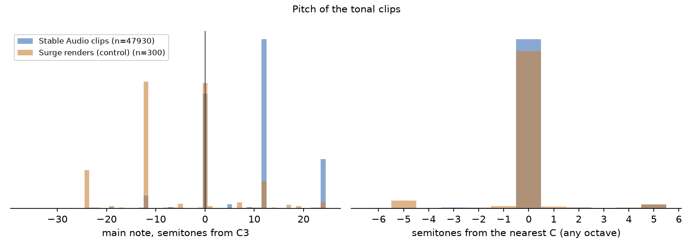
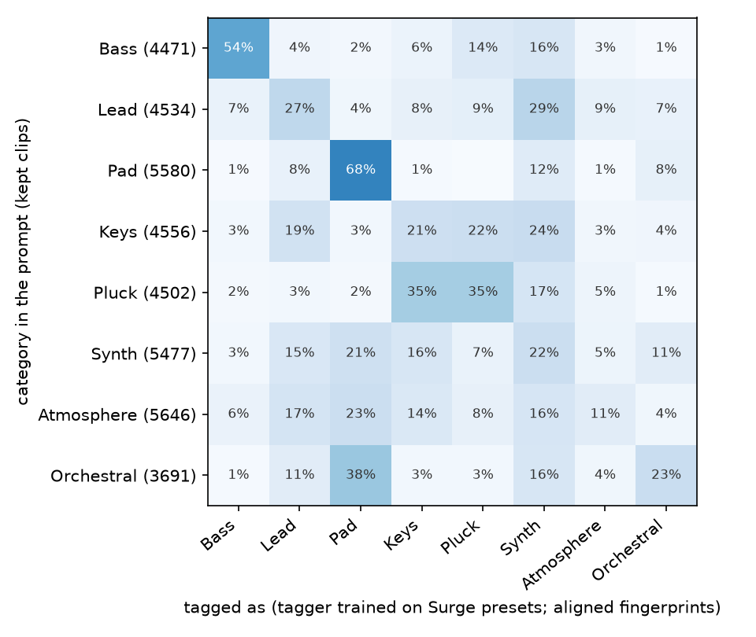
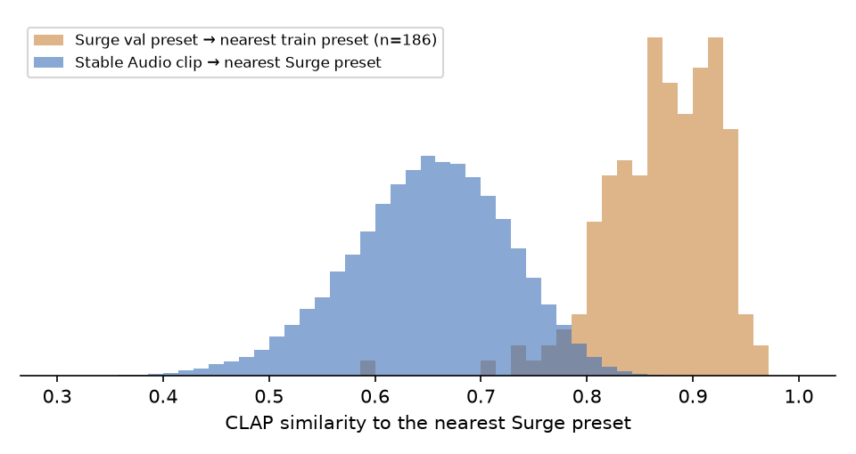

# Stable Audio pilot report: main_small-music

48000 clips (12000 prompts × 4 seeds). Generated by `pitcher/text2preset/postprocess.py` + `pilot_report.py`.

## 1. Filter

**Kept: 96.3%** (46220 clips). Thresholds calibrated on 300 Surge renders analysed with the same code.

| Flag | Meaning | Rejects? | Stable Audio | Surge renders |
|---|---|---|---|---|
| silent | loudest 50 ms below -50 dBFS | yes | 0.0% | – |
| multi_note | two or more distinct held notes (melody, arpeggio, chord change) | yes | 3.7% | 5.7% |
| rhythmic | percussive share and onsets both above the Surge 98th percentile (drums, loops) | yes | 0.0% | 0.0% |
| off_pitch | tonal, main note more than 1 semitone from any C | no, marked | 5.0% | 10.7% |
| chord_like | partials don't fit one note (harmonic fit below the Surge 5th percentile): chord or inharmonic | no, marked | 1.6% | 5.0% |
| cut_off | still within 20 dB of its peak at the end of the 6 s clip | no, marked | 2.2% | – |
| clipped | more than 10 samples at full scale | no, marked | 2.6% | – |

By kind:

| kind         |   clips |   kept | tagged_top   |
|:-------------|--------:|-------:|:-------------|
| generic      |    5760 |   0.95 | Keys         |
| main         |   39840 |   0.97 | Keys         |
| out_of_range |    2400 |   0.96 | Keys         |

## 2. Pitch (asked: C3)

Tonal clips: 99.9%. Within ±1 semitone of **any C**: **95.0%** (Surge renders, all played on the C3 key: 89.3%). Within ±1 semitone of C3 itself: 31.2% (Surge: 34.7%; many Surge presets have octave switches, so a bass played on the C3 key often sounds at C1 or C2). Median: +12.0 semitones from C3.

## 3. Category (kept main clips, tagger trained on Surge presets)

Balanced agreement with the prompt's category: raw fingerprints 23.7%; **after domain alignment 32.7%** (the same tagger on real, unseen Surge presets: 51.9%; chance 12.5%). Domain gap: the mean Stable Audio fingerprint and the mean Surge fingerprint have cosine 0.44, so the raw tagger sees most clips as one category; the alignment shifts all clips by the difference of the two means (no labels used; the same gain holds when the shift is estimated on half of the prompts). Matrix below: aligned.

## 4. Per category

| category   |   clips |   kept |   multi_note |   rhythmic |   off_pitch |   chord_like |   tagger_recall |   recall_aligned |   median_semis_from_c3 |   text_rank |   surge_nn |
|:-----------|--------:|-------:|-------------:|-----------:|------------:|-------------:|----------------:|-----------------:|-----------------------:|------------:|-----------:|
| Bass       |    4688 |   0.95 |         0.05 |       0.00 |        0.07 |         0.02 |            0.12 |             0.54 |                  -0.00 |     1928.00 |       0.70 |
| Lead       |    4688 |   0.97 |         0.03 |       0.00 |        0.09 |         0.01 |            0.01 |             0.27 |                  12.00 |     4627.00 |       0.62 |
| Pad        |    5624 |   0.99 |         0.01 |       0.00 |        0.01 |         0.00 |            0.60 |             0.68 |                  12.00 |     1418.00 |       0.64 |
| Keys       |    4688 |   0.97 |         0.03 |       0.00 |        0.04 |         0.02 |            0.72 |             0.21 |                  12.00 |     3307.00 |       0.66 |
| Pluck      |    4688 |   0.96 |         0.04 |       0.00 |        0.03 |         0.02 |            0.06 |             0.35 |                  12.00 |     2152.50 |       0.64 |
| Synth      |    5624 |   0.97 |         0.03 |       0.00 |        0.03 |         0.01 |            0.11 |             0.22 |                  12.00 |     4868.00 |       0.67 |
| Atmosphere |    6092 |   0.93 |         0.07 |       0.00 |        0.08 |         0.03 |            0.09 |             0.11 |                  12.00 |     5427.00 |       0.65 |
| Orchestral |    3748 |   0.98 |         0.02 |       0.00 |        0.03 |         0.00 |            0.19 |             0.23 |                  12.00 |     3409.00 |       0.64 |

## 5. Does the description match? (CLAP text ↔ audio)

Rank of the clip's own description among all 12000: median **3436** (random: 6000); in the top 10%: 25.6%. By kind: generic 5442, main 3288, out_of_range 2006. CLAP text matching is weak on our sounds (Round 18: 20% zero-shot), so this is a coarse check.

## 6. Descriptor words → measured sound (kept main clips)

| slot       | value        |    n | measure                                |   measured |   without_slot |
|:-----------|:-------------|-----:|:---------------------------------------|-----------:|---------------:|
| brightness | airy         | 1293 | brightness: octaves vs category median |      0.118 |          0.001 |
| brightness | bright       | 2003 | brightness: octaves vs category median |      0.202 |          0.001 |
| brightness | cold         | 1608 | brightness: octaves vs category median |     -0.019 |          0.001 |
| brightness | dark         | 2188 | brightness: octaves vs category median |     -0.289 |          0.001 |
| brightness | piercing     | 1721 | brightness: octaves vs category median |      0.234 |          0.001 |
| brightness | warm         | 2427 | brightness: octaves vs category median |     -0.080 |          0.001 |
| attack     | percussive   | 2090 | attack time (s), 75th percentile       |      0.000 |          0.110 |
| attack     | punchy       | 2681 | attack time (s), 75th percentile       |      0.110 |          0.110 |
| attack     | slow         | 2710 | attack time (s), 75th percentile       |      0.360 |          0.110 |
| attack     | snappy       | 2990 | attack time (s), 75th percentile       |      0.040 |          0.110 |
| length     | decaying     | 2726 | level after 2 s (dB vs peak)           |    -11.860 |        -12.935 |
| length     | long_release | 2090 | level after 2 s (dB vs peak)           |    -11.029 |        -12.935 |
| length     | short        | 2177 | level after 2 s (dB vs peak)           |    -14.151 |        -12.935 |
| length     | sustained    | 3410 | level after 2 s (dB vs peak)           |     -7.320 |        -12.935 |
| grit       | aggressive   | 1738 | noisiness: spectral flatness (dB)      |    -43.947 |        -48.004 |
| grit       | buzzy        | 1676 | noisiness: spectral flatness (dB)      |    -45.769 |        -48.004 |
| grit       | clean        | 1663 | noisiness: spectral flatness (dB)      |    -50.058 |        -48.004 |
| grit       | gritty       | 2379 | noisiness: spectral flatness (dB)      |    -48.724 |        -48.004 |
| grit       | rough        | 1740 | noisiness: spectral flatness (dB)      |    -47.794 |        -48.004 |
| grit       | soft         | 1688 | noisiness: spectral flatness (dB)      |    -49.407 |        -48.004 |

## 7. Can Surge reach these sounds?

CLAP similarity to the nearest Surge preset (raw fingerprints, plot): median **0.653**; a real unseen Surge preset to its nearest train preset: 0.875. Clips at least as close as the 10th percentile of that reference: 0.8%. After domain alignment: median 0.798 (partly by construction, since the shift moves the clips towards the Surge set). Much of the raw gap is the domain difference (section 3); how far Surge can really reach these sounds is a question for version A and a listening test.

## 8. Seeds

Mean CLAP similarity between the 4 seeds of a prompt: median 0.820.

## 9. Prompts with the fewest kept clips

|   prompt_id |   kept | prompt                                                                                                                                         |
|------------:|-------:|:-----------------------------------------------------------------------------------------------------------------------------------------------|
|        2039 |   0.00 | Aggressive G-funk-style lead with a sharp attack, single note, C3, one-shot, dry, no reverb, synthesizer, no drums, no melody                  |
|        1621 |   0.00 | Playful 90s piercing deep whistle lead with chorus, single note, C3, one-shot, dry, no reverb, synthesizer, no drums, no melody                |
|        5116 |   0.00 | Synthwave kalimba-like pluck with a slowly opening filter, single note, C3, one-shot, dry, no reverb, synthesizer, no drums, no melody         |
|         142 |   0.00 | Calm thick neuro bass with tremolo and a percussive hit, single note, C3, one-shot, dry, no reverb, synthesizer, no drums, no melody           |
|         670 |   0.00 | Cinematic fat percussive neurofunk bass, single note, C3, one-shot, dry, no reverb, synthesizer, no drums, no melody                           |
|         311 |   0.00 | Lo-fi zappy neuro bass with a sharp attack, single note, C3, one-shot, dry, no reverb, synthesizer, no drums, no melody                        |
|         396 |   0.00 | Eerie round fat neuro bass with a growl, single note, C3, one-shot, dry, no reverb, synthesizer, no drums, no melody                           |
|        6409 |   0.00 | Dark resonant poly synth with a punchy attack, single note, C3, one-shot, dry, no reverb, synthesizer, no drums, no melody                     |
|        9571 |   0.00 | 80s buzzy violin-like synth with a rising pitch and a slow attack, single note, C3, one-shot, dry, no reverb, synthesizer, no drums, no melody |
|        1842 |   0.25 | Bright degraded square lead with a punchy attack, single note, C3, one-shot, dry, no reverb, synthesizer, no drums, no melody                  |
|        2493 |   0.25 | Ambient sterile synth pad that slowly decays, single note, C3, one-shot, dry, no reverb, synthesizer, no drums, no melody                      |
|         956 |   0.25 | Glassy sub with a punchy attack, single note, C3, one-shot, dry, no reverb, synthesizer, no drums, no melody                                   |
