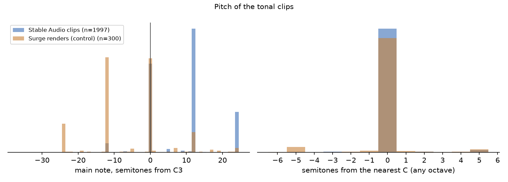
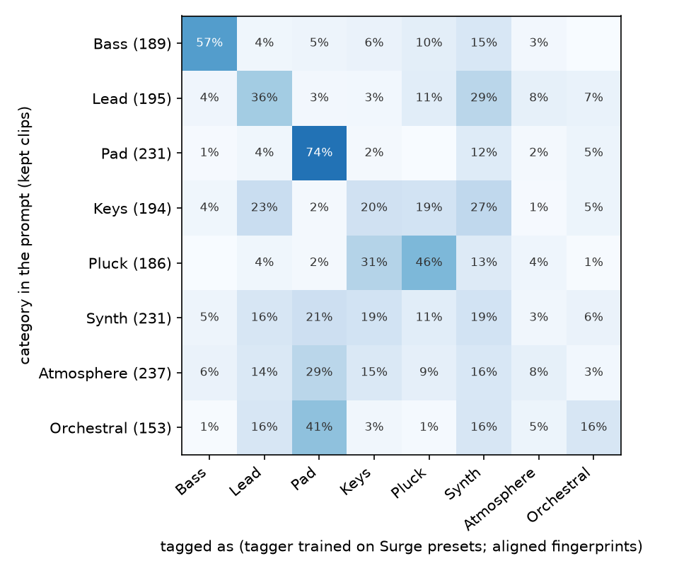
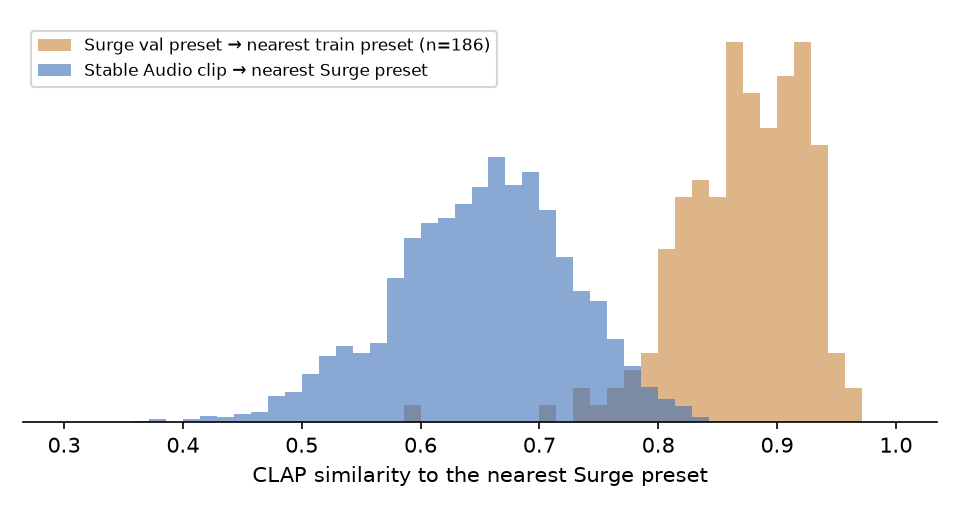

# Stable Audio pilot report: pilot_small-music

2000 clips (500 prompts × 4 seeds). Generated by `pitcher/text2preset/postprocess.py` + `pilot_report.py`.

## 1. Filter

**Kept: 97.2%** (1943 clips). Thresholds calibrated on 300 Surge renders analysed with the same code.

| Flag | Meaning | Rejects? | Stable Audio | Surge renders |
|---|---|---|---|---|
| silent | loudest 50 ms below -50 dBFS | yes | 0.0% | – |
| multi_note | two or more distinct held notes (melody, arpeggio, chord change) | yes | 2.9% | 5.7% |
| rhythmic | percussive share and onsets both above the Surge 98th percentile (drums, loops) | yes | 0.0% | 0.0% |
| off_pitch | tonal, main note more than 1 semitone from any C | no, marked | 4.0% | 10.7% |
| chord_like | partials don't fit one note (harmonic fit below the Surge 5th percentile): chord or inharmonic | no, marked | 1.1% | 5.0% |
| cut_off | still within 20 dB of its peak at the end of the 6 s clip | no, marked | 2.1% | – |
| clipped | more than 10 samples at full scale | no, marked | 2.5% | – |

By kind:

| kind         |   clips |   kept | tagged_top   |
|:-------------|--------:|-------:|:-------------|
| generic      |     240 |   0.96 | Keys         |
| main         |    1660 |   0.97 | Keys         |
| out_of_range |     100 |   0.96 | Keys         |

## 2. Pitch (asked: C3)

Tonal clips: 99.9%. Within ±1 semitone of **any C**: **96.0%** (Surge renders, all played on the C3 key: 89.3%). Within ±1 semitone of C3 itself: 32.2% (Surge: 34.7%; many Surge presets have octave switches, so a bass played on the C3 key often sounds at C1 or C2). Median: +12.0 semitones from C3.

## 3. Category (kept main clips, tagger trained on Surge presets)

Balanced agreement with the prompt's category: raw fingerprints 23.0%; **after domain alignment 34.5%** (the same tagger on real, unseen Surge presets: 51.9%; chance 12.5%). Domain gap: the mean Stable Audio fingerprint and the mean Surge fingerprint have cosine 0.44, so the raw tagger sees most clips as one category; the alignment shifts all clips by the difference of the two means (no labels used; the same gain holds when the shift is estimated on half of the prompts). Matrix below: aligned.

## 4. Per category

| category   |   clips |   kept |   multi_note |   rhythmic |   off_pitch |   chord_like |   tagger_recall |   recall_aligned |   median_semis_from_c3 |   text_rank |   surge_nn |
|:-----------|--------:|-------:|-------------:|-----------:|------------:|-------------:|----------------:|-----------------:|-----------------------:|------------:|-----------:|
| Bass       |     196 |   0.96 |         0.04 |       0.00 |        0.06 |         0.01 |            0.14 |             0.57 |                  -0.00 |       74.00 |       0.69 |
| Lead       |     196 |   0.99 |         0.01 |       0.00 |        0.13 |         0.01 |            0.01 |             0.36 |                  12.00 |      147.00 |       0.64 |
| Pad        |     232 |   1.00 |         0.00 |       0.00 |        0.00 |         0.01 |            0.65 |             0.74 |                  12.00 |       43.00 |       0.64 |
| Keys       |     196 |   0.99 |         0.01 |       0.00 |        0.02 |         0.02 |            0.65 |             0.20 |                  12.00 |      129.00 |       0.65 |
| Pluck      |     196 |   0.95 |         0.05 |       0.00 |        0.02 |         0.01 |            0.05 |             0.46 |                  12.10 |       61.50 |       0.66 |
| Synth      |     236 |   0.98 |         0.02 |       0.00 |        0.01 |         0.00 |            0.11 |             0.19 |                  12.00 |      173.00 |       0.68 |
| Atmosphere |     252 |   0.94 |         0.06 |       0.00 |        0.04 |         0.03 |            0.06 |             0.08 |                  12.00 |      252.00 |       0.66 |
| Orchestral |     156 |   0.98 |         0.02 |       0.00 |        0.03 |         0.01 |            0.18 |             0.16 |                  12.00 |      172.00 |       0.62 |

## 5. Does the description match? (CLAP text ↔ audio)

Rank of the clip's own description among all 500: median **139** (random: 250); in the top 10%: 25.5%. By kind: generic 300, main 127, out_of_range 108. CLAP text matching is weak on our sounds (Round 18: 20% zero-shot), so this is a coarse check.

## 6. Descriptor words → measured sound (kept main clips)

| slot       | value        |   n | measure                                |   measured |   without_slot |
|:-----------|:-------------|----:|:---------------------------------------|-----------:|---------------:|
| brightness | airy         |  49 | brightness: octaves vs category median |      0.446 |          0.000 |
| brightness | bright       |  64 | brightness: octaves vs category median |      0.342 |          0.000 |
| brightness | cold         |  75 | brightness: octaves vs category median |      0.042 |          0.000 |
| brightness | dark         |  74 | brightness: octaves vs category median |     -0.335 |          0.000 |
| brightness | piercing     |  75 | brightness: octaves vs category median |      0.042 |          0.000 |
| brightness | warm         |  92 | brightness: octaves vs category median |     -0.162 |          0.000 |
| attack     | percussive   |  74 | attack time (s), 75th percentile       |      0.007 |          0.110 |
| attack     | punchy       | 119 | attack time (s), 75th percentile       |      0.015 |          0.110 |
| attack     | slow         | 138 | attack time (s), 75th percentile       |      0.287 |          0.110 |
| attack     | snappy       |  86 | attack time (s), 75th percentile       |      0.080 |          0.110 |
| length     | decaying     |  88 | level after 2 s (dB vs peak)           |    -10.894 |        -13.182 |
| length     | long_release |  62 | level after 2 s (dB vs peak)           |    -12.570 |        -13.182 |
| length     | short        |  67 | level after 2 s (dB vs peak)           |    -10.913 |        -13.182 |
| length     | sustained    |  99 | level after 2 s (dB vs peak)           |     -8.232 |        -13.182 |
| grit       | aggressive   |  47 | noisiness: spectral flatness (dB)      |    -37.669 |        -48.095 |
| grit       | buzzy        |  51 | noisiness: spectral flatness (dB)      |    -45.446 |        -48.095 |
| grit       | clean        |  93 | noisiness: spectral flatness (dB)      |    -46.984 |        -48.095 |
| grit       | gritty       | 102 | noisiness: spectral flatness (dB)      |    -44.268 |        -48.095 |
| grit       | rough        |  56 | noisiness: spectral flatness (dB)      |    -52.261 |        -48.095 |
| grit       | soft         |  62 | noisiness: spectral flatness (dB)      |    -52.020 |        -48.095 |

## 7. Can Surge reach these sounds?

CLAP similarity to the nearest Surge preset (raw fingerprints, plot): median **0.657**; a real unseen Surge preset to its nearest train preset: 0.875. Clips at least as close as the 10th percentile of that reference: 0.9%. After domain alignment: median 0.799 (partly by construction, since the shift moves the clips towards the Surge set). Much of the raw gap is the domain difference (section 3); how far Surge can really reach these sounds is a question for version A and a listening test.

## 8. Seeds

Mean CLAP similarity between the 4 seeds of a prompt: median 0.821.

## 9. Prompts with the fewest kept clips

|   prompt_id |   kept | prompt                                                                                                                        |
|------------:|-------:|:------------------------------------------------------------------------------------------------------------------------------|
|         360 |   0.25 | Lo-fi whoosh with a slow attack, single note, C3, one-shot, dry, no reverb, synthesizer, no drums, no melody                  |
|         218 |   0.25 | Raw fat vibraphone-like synth that slowly decays, single note, C3, one-shot, dry, no reverb, synthesizer, no drums, no melody |
|         333 |   0.50 | Glass-like drone, single note, C3, one-shot, dry, no reverb, synthesizer, no drums, no melody                                 |
|         336 |   0.50 | Dull riser, single note, C3, one-shot, dry, no reverb, synthesizer, no drums, no melody                                       |
|         209 |   0.50 | Dark marimba-like pluck, single note, C3, one-shot, dry, no reverb, synthesizer, no drums, no melody                          |
|          24 |   0.50 | Delicate 808 with a snappy start, single note, C3, one-shot, dry, no reverb, synthesizer, no drums, no melody                 |
|         328 |   0.50 | Clean airy slow-attack uplifter, single note, C3, one-shot, dry, no reverb, synthesizer, no drums, no melody                  |
|         300 |   0.50 | Detuned poly synth with a percussive hit, single note, C3, one-shot, dry, no reverb, synthesizer, no drums, no melody         |
|         326 |   0.75 | Buzzy drone with a slow attack, single note, C3, one-shot, dry, no reverb, synthesizer, no drums, no melody                   |
|         340 |   0.75 | Spacey atmosphere, single note, C3, one-shot, dry, no reverb, synthesizer, no drums, no melody                                |
|         353 |   0.75 | Slow-attack riser, single note, C3, one-shot, dry, no reverb, synthesizer, no drums, no melody                                |
|         355 |   0.75 | Gritty full sine sweep, single note, C3, one-shot, dry, no reverb, synthesizer, no drums, no melody                           |
